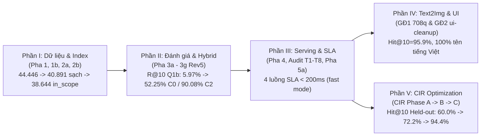

# BÁO CÁO TỔNG QUAN TOÀN BỘ CÁC PHA CỦA TẤT CẢ CÁC PHẦN
**Dự án:** Hệ thống Tra cứu Sản phẩm Thời trang Đa phương thức Tiếng Việt (`Hoc_sau_ver4`)  
**Mô hình nền tảng:** `MultimodalSigLIPWithCIR` (`google/siglip-so400m-patch14-224`, 1152-d, `UpgradedAttentionCIRCombiner`)  
**Checkpoint SHA-256:** `e2f82fee26c786c2ea9e521d8341e7bbfc29c0980cebac46688c5522ff64215d`  
**Phần cứng kiểm thử:** NVIDIA GeForce RTX 2050 Mobile (4 GB VRAM), FP16 Inference, Windows 11  
**Ngày tổng hợp:** 2026-11-11

---

## MỤC LỤC
1. [Tóm tắt Điều hành & Bức tranh Toàn cảnh](#1-tóm-tắt-điều-hành--bức-tranh-toàn-cảnh)
2. [Bảng Đối chiếu Chỉ tiêu Dự án & Trạng thái Đạt chuẩn](#2-bảng-đối-chiếu-chỉ-tiêu-dự-án--trạng-thái-đạt-chuẩn)
3. [Phần 0 — Nền tảng, Kiến trúc Checkpoint & Quy tắc Bất biến](#3-phần-0--nền-tảng-kiến-trúc-checkpoint--quy-tắc-bất-biến)
4. [Phần I — Xử lý Dữ liệu, Làm sạch Catalog & Xây dựng Index (Pha 1 → Pha 2b)](#4-phần-i--xử-lý-dữ-liệu-làm-sạch-catalog--xây-dựng-index-pha-1--pha-2b)
5. [Phần II — Đánh giá Mô hình, Chẩn đoán Gốc rễ & Tối ưu Suy luận Thuần (Pha 3a → Pha 3g)](#5-phần-ii--đánh-giá-mô-hình-chẩn-đoán-gốc-rễ--tối-ưu-suy-luận-thuần-pha-3a--pha-3g)
6. [Phần III — Ứng dụng Phục vụ, Kiểm toán Toàn diện & SLA 4 Luồng (Pha 4 → Pha 5a)](#6-phần-iii--ứng-dụng-phục-vụ-kiểm-toán-toàn-diện--sla-4-luồng-pha-4--pha-5a)
7. [Phần IV — Kiểm thử Text→Ảnh Toàn diện, Tiếng Việt hóa & Làm sạch Giao diện (Pha 5 GĐ1–GĐ2 / UI Cleanup)](#7-phần-iv--kiểm-thử-textảnh-toàn-diện-tiếng-việt-hóa--làm-sạch-giao-diện-pha-5-gđ1gđ2--ui-cleanup)
8. [Phần V — Tra cứu Đa phương thức CIR (Phase A → Phase B → Phase C)](#8-phần-v--tra-cứu-đa-phương-thức-cir-phase-a--phase-b--phase-c)
9. [Các Điểm Giới hạn, Đính chính Kiểm toán & Hạng mục Mở](#9-các-điểm-giới-hạn-đính-chính-kiểm-toán--hạng-mục-mở)
10. [Phụ lục Đường dẫn Tài liệu & Mã nguồn Cốt lõi](#10-phụ-lục-đường-dẫn-tài-liệu--mã-nguồn-cốt-lõi)

---

## 1. Tóm tắt Điều hành & Bức tranh Toàn cảnh

Dự án `Hoc_sau_ver4` xây dựng hệ thống tìm kiếm sản phẩm thời trang đa phương thức bằng tiếng Việt hỗ trợ 3 luồng nghiệp vụ chính trên nền tảng tập dữ liệu Kaggle Fashion (`styles.csv`, 44,446 dòng gốc → **38,644 sản phẩm `in_scope`** sau làm sạch và kiểm toán):
1. **Text → Ảnh (`text_to_image`):** Tìm kiếm sản phẩm từ truy vấn tiếng Việt tự nhiên (có dấu, không dấu, đồng nghĩa, thương hiệu).
2. **Ảnh → Ảnh (`image_to_image`):** Tìm kiếm sản phẩm tương đồng thị giác từ ảnh mẫu catalog (loại trừ chính nó) hoặc ảnh tải lên.
3. **Ảnh + Text điều chỉnh (`cir_catalog` / `cir_upload`):** Tra cứu kết hợp đa phương thức (Composed Image Retrieval — giữ đặc trưng ảnh mẫu và biến đổi màu sắc, giới tính, hoặc loại sản phẩm theo yêu cầu chữ).

Toàn bộ quá trình phát triển trải qua **5 Phần lớn** với các pha kiểm toán, đối soát nghiêm ngặt, tuân thủ **Luật bất biến** (không huấn luyện lại checkpoint, không xóa ảnh vĩnh viễn, không làm sai lệch số liệu, tách bạch tuyệt đối **"Model thuần"** và **"Hệ thống"**).

### Bức tranh Tiến hóa Các Pha theo Dòng thời gian

| Phần | Pha / Giai đoạn | Mục tiêu & Hành động chính | Kết quả / Thay đổi bước ngoặt | Tài liệu nguồn |
|---|---|---|---|---|
| **0** | **Khởi tạo & Khảo sát** | Chốt `config.yaml`, `AGENTS.md`, nạp checkpoint `best_model.pt` | Chuẩn hóa tham số huấn luyện: SigLIP-SO400M, 1152-d, `max_length=128`, `padding=max_length` | [`config.yaml`](file:///d:/K%C3%AC%207/Hoc_sau_ver4/config.yaml) |
| **I** | **Pha 1 (1a)** | Lọc chất lượng ảnh (`low_res`, `blurry`, `banner`, `duplicate`) | Cách ly 16,754 ảnh (37.72%); phát hiện lỗi gom cụm pHash bắc cầu loại oan ảnh khác màu | [`phase1_report.md`](file:///d:/K%C3%AC%207/Hoc_sau_ver4/reports/phase1/phase1a/phase1_report.md) |
| **I** | **Pha 1b** | Sửa deduplication (cùng Type+Gender+Colour, pHash ≤ 1) | Khôi phục **13,226 ảnh**; catalog sạch tăng từ 27,665 lên **40,891 sản phẩm** | [`phase1b_report.md`](file:///d:/K%C3%AC%207/Hoc_sau_ver4/reports/phase1/phase1b/phase1b_report.md) |
| **I** | **Pha 2a – 2b** | Smoke test, xác định `in_scope`, build embedding & FAISS HNSW | ANN Recall@10 = 99.95% (`efSearch=128`); xác định 1,290 sp `test` `in_scope` | [`phase2a_findings.md`](file:///d:/K%C3%AC%207/Hoc_sau_ver4/reports/phase2/phase2a/phase2a_findings.md), [`phase2_report.md`](file:///d:/K%C3%AC%207/Hoc_sau_ver4/reports/phase2/phase2b/phase2_report.md) |
| **II** | **Pha 3a – 3b** | Đánh giá cố định v1 & Chẩn đoán 9 bước D0–D8 | Phát hiện Q1b thấp (5.97%) do cắt cụt >128 token (52.3%), Hubness (67% vào Handbag), lệch resize BICUBIC | [`phase3_eval.md`](file:///d:/K%C3%AC%207/Hoc_sau_ver4/reports/phase3/phase3a/phase3_eval.md), [`phase3b_diagnosis.md`](file:///d:/K%C3%AC%207/Hoc_sau_ver4/reports/phase3/phase3b/phase3b_diagnosis.md) |
| **II** | **Pha 3c – 3d** | Xây `index_v2` chuẩn BILINEAR; bổ sung Q4 loại self & trần lý thuyết | R@10 Model thuần tăng **8.9x** (5.97% → **53.26%** CSLS / **52.25%** Mean-Center) | [`phase3c_eval_v2.md`](file:///d:/K%C3%AC%207/Hoc_sau_ver4/reports/phase3/phase3c/phase3c_eval_v2.md), [`phase3d_addendum.md`](file:///d:/K%C3%AC%207/Hoc_sau_ver4/reports/phase3/phase3d/phase3d_addendum.md) |
| **II** | **Pha 3e – 3f** | Suy luận thuần Hybrid (Parser + L0..L6 + Soft Bonus + BM25) & Đối soát | Đóng băng $\gamma^*=0.3, \alpha^*=1.0, k=60$; Q1b $G_{test}$ **C2 đạt R@10 = 0.9008**; C5 p95 = 69.75 ms | [`phase3e_inference_only.md`](file:///d:/K%C3%AC%207/Hoc_sau_ver4/reports/phase3/phase3e/phase3e_inference_only.md), [`phase3f_reconciliation.md`](file:///d:/K%C3%AC%207/Hoc_sau_ver4/reports/phase3/phase3f/phase3f_reconciliation.md) |
| **II** | **Pha 3g (Rev1–5)** | Chuỗi Errata kiểm toán, `brands_v2`, `QueryParserV2`, Blind A/B | Loại 2 Keychain → **38,644 sp**; sửa bug `"đồ"→Red`; Blind A/B C5 thắng **29/30** (Claude AI) | [`phase3f_errata.md`](file:///d:/K%C3%AC%207/Hoc_sau_ver4/reports/phase3/phase3f/phase3f_errata.md) |
| **III** | **Pha 4 (Audit & Fix)** | App Streamlit (`SearchService`), Kiểm toán T1–T8, Unseen Testset v2, GT Giới tính | Sửa bug `colour` GT; Q3 Hybrid **0.9180**; Unseen v2 ($G_{full}$) AP@10 = **0.7864** | [`phase4_audit_final.md`](file:///d:/K%C3%AC%207/Hoc_sau_ver4/reports/phase4/phase4_audit_final.md), [`phase4_fix_report_v2.md`](file:///d:/K%C3%AC%207/Hoc_sau_ver4/reports/phase4/phase4_fix_report_v2.md) |
| **III** | **Pha 5 (5a)** | Tách `i2i_mode` (`fast`/`accurate`), benchmark SLA 4 luồng v3 | **4/4 luồng đạt SLA p95 < 200 ms** ở cấu hình mặc định (`i2i_mode=fast`) | [`README_run.md`](file:///d:/K%C3%AC%207/Hoc_sau_ver4/README_run.md), [`phase4_latency_e2e_v3.json`](file:///d:/K%C3%AC%207/Hoc_sau_ver4/reports/phase4/phase4_latency_e2e_v3.json) |
| **IV** | **Text2Img & UI Cleanup** | Kiểm thử 708 câu (16 nhóm A–P), dịch 100% tên tiếng Việt, sửa thẻ HTML | C5 Hit@10 = **95.9%**, P@10 = **83.8%**; 0 rò rỉ tiếng Anh, 0 lỗi `
` thô | [`BAO_CAO_TEXT2IMG.md`](file:///d:/K%C3%AC%207/Hoc_sau_ver4/eval/text2img_test/BAO_CAO_TEXT2IMG.md), [`UI_CHANGELOG.md`](file:///d:/K%C3%AC%207/Hoc_sau_ver4/eval/text2img_test/UI_CHANGELOG.md) |
| **V** | **CIR Phase A → B → C** | Chẩn đoán sụp đổ tiếng Việt → Dịch P2 → Neo danh mục động & Slider $\lambda$ | Held-out 90 ca Hit@10 tăng **60.0% → 72.2% → 94.4%** ($\lambda=1.0$) / **90.0%** ($\lambda=0.5$), TypeRet = **100%** | [`BAO_CAO_CIR.md`](file:///d:/K%C3%AC%207/Hoc_sau_ver4/eval/cir_test/BAO_CAO_CIR.md), [`step3_heldout_ablation.json`](file:///d:/K%C3%AC%207/Hoc_sau_ver4/eval/cir_test/results/step3_heldout_ablation.json) |

---

## 2. Bảng Đối chiếu Chỉ tiêu Dự án & Trạng thái Đạt chuẩn

Tuân thủ tuyệt đối quy tắc đánh giá trong [`.agents/AGENTS.md`](file:///d:/K%C3%AC%207/Hoc_sau_ver4/.agents/AGENTS.md):
- Chỉ tiêu chính thức chỉ đối chiếu trên tập test độc lập (`split == "test"`, $G_{test} = 1,290$ sản phẩm) và **tách riêng "Model thuần" vs "Hệ thống"**.
- Số liệu trên $G_{full}$ ($38,644$ sản phẩm, có chứa ảnh train `unknown`) được ghi rõ là **ước lượng lạc quan (tham khảo)**.
- Độ trễ SLA tính **tách biệt cho từng luồng** theo `latency.sla_metric: "p95" < 200 ms` trong [`config.yaml`](file:///d:/K%C3%AC%207/Hoc_sau_ver4/config.yaml).

### 2.1. Chỉ tiêu Chất lượng Tìm kiếm (Accuracy / Retrieval)

| Bài toán & Bộ dữ liệu | Gallery | Đối tượng đo | Recall@10 | mAP / MRR / AP@10 | Chỉ tiêu gốc | Trạng thái |
|---|---|---|---|---|---|---|
| **Q1b Paired Text→Ảnh** ($n=1,290$) | $G_{test}$ (1,290) | **Model thuần (C0 Mean-Center)** | **0.5225** | **0.2362** *(mAP=MRR)* | R@10 ≥ 0.85, mAP ≥ 0.75 | 🔴 **CHƯA ĐẠT** (Giới hạn checkpoint gốc) |
| **Q1b Paired Text→Ảnh** ($n=1,290$) | $G_{test}$ (1,290) | **Hệ thống C2 (Parser + Soft Bonus)** | **0.9008** | **0.5205** *(mAP=MRR)* | R@10 ≥ 0.85 *(chỉ tiêu gốc cho model)* | 🟡 **Hệ thống đạt R@10, chưa đạt mAP** |
| **Q1b Paired Text→Ảnh** ($n=1,290$) | $G_{full}$ *(Lạc quan)* | Model thuần (C0) vs Hệ thống (C2) | 0.0628 vs **0.2682** | 0.0300 vs **0.1170** *(MRR)* | Tham khảo lạc quan | ℹ️ Nhiễu 37k ảnh cùng loại |
| **Q6 Usage/Season** ($n=120$) | $G_{test}$ (1,290) | Model thuần (C0) vs Hệ thống (C5) | — *(thuộc tính)* | AP@10: 0.2091 vs **0.5172** | Không lọc usage/season | ℹ️ Hit@10 = 0.9167 |
| **Q2 Thuộc tính tổ hợp** ($n=61$) | $G_{test}$ / $G_{full}$* | Hệ thống (C5) | — | AP@10: **0.9457** / **0.9982*** | P@10: 0.7230 / **0.9984*** | 🟢 Vượt trội C0 (0.4300 / 0.5373) |
| **Q3 Viết tay (50 câu, GT 3 chính sách)** | $G_{full}$ *(Lạc quan)* | Hệ thống (C5) | — | P@10: **Hybrid 0.9180** / Strict 0.9010 / Relaxed 0.9180 | Chính sách GT đóng băng | 🟢 `gender_gt_policy.json` |
| **Unseen Testset v2** ($n=32$) | $G_{full}$ *(Lạc quan)* | Hệ thống (C5, chạy 1 lần) | — | **Mean AP@10 = 0.7864** ($n=31$ $R>0$) | Tham khảo $\ge 0.75$ trên $G_{full}$ | 🟢 **VƯỢT 0.75** (P@10 = 0.8065) |
| **Text→Ảnh Toàn diện** ($n=708$) | $G_{full}$ *(Lạc quan)* | Model thuần (C0) vs Hệ thống (C5) | — | Hit@10: 49.8% vs **95.9%** | P@10: 27.4% vs **83.8%** | 🟢 C5 +46.1% Hit@10 |
| **Q4 Ảnh→Ảnh** ($n=1,256$ hợp lệ, loại self) | $G_{test}$ (1,290) | `fast` (1 ảnh) vs `accurate` (Batch-2 TTA) | Paired Self: **1.0000** | Attr NN AP@10: **0.6830** vs 0.6822 | P@10: **0.6998** vs 0.6997 | 🟢 `fast` tương đương `accurate` |
| **CIR Held-out** ($n=90$, `cir_heldout.csv`) | $G_{full}$ *(Lạc quan)* | Phase B vs Phase C ($\lambda=1.0$ / $\lambda=0.5$) | — | Hit@10: 72.2% → **94.4%** / **90.0%** | TypeRet: 63.1% → **100.0%** | 🟢 Phase C tăng +22.2% Hit@10 |

*\*Ghi chú: Các số có đánh dấu `*` trên $G_{full}$ luôn là ước lượng lạc quan (tham khảo) theo Rule 24.*

### 2.2. Chỉ tiêu Độ trễ SLA Riêng Từng Luồng (Benchmark v3 — 5 Runs × 200 Queries/Luồng)

Đo kiểm chuẩn hóa trong [`phase4_latency_e2e_v3.json`](file:///d:/K%C3%AC%207/Hoc_sau_ver4/reports/phase4/phase4_latency_e2e_v3.json) với 20 warmup queries, Latin-square rotation, `torch.cuda.synchronize()` quanh forward, GPU RTX 2050 Mobile (nhiệt độ tối đa 86–87°C, **0/5,000 lượt vượt 500 ms**):

| Luồng nghiệp vụ (`config.yaml`) | Chế độ phục vụ | p50 Trung vị (ms) | p95 Trung bình (ms) | Dải p95 qua 5 Runs (ms) | p99 Trung vị (ms) | Số lượt > 200 ms | Số Run đạt p95 < 200 ms | Kết luận SLA |
|---|---|---:|---:|---:|---:|---:|:---:|---|
| **`text_to_image`** | C5 Hybrid (Mặc định) | 32.15 | **67.71** | `61.10 – 76.10` | 96.34 | 0 / 1,000 | **5 / 5** | 🟢 **ĐẠT TUYỆT ĐỐI** |
| **`image_to_image`** (`fast`) | 1 ảnh gốc (**Mặc định**) | 85.43 | **143.38** | `130.67 – 155.49` | 180.50 | 10 / 1,000 | **5 / 5** | 🟢 **ĐẠT SLA** |
| **`image_to_image`** (`accurate`) | Batch-2 TTA Flip | 139.22 | **211.45** | `195.52 – 222.57` | 257.12 | 80 / 1,000 | **1 / 5** | 🔴 **KHÔNG ĐẠT** |
| **`cir_catalog`** | GPU Cache Embedding | 33.22 | **66.50** | `57.05 – 71.00` | 103.65 | 1 / 1,000 | **5 / 5** | 🟢 **ĐẠT SLA** |
| **`cir_upload`** | ViT Forward Pass | 107.32 | **176.08** | `162.23 – 197.49` | 239.08 | 37 / 1,000 | **5 / 5** | 🟢 **ĐẠT SLA** |

---

## 3. Phần 0 — Nền tảng, Kiến trúc Checkpoint & Quy tắc Bất biến

### 3.1. Kiến trúc Mô hình & Tham số Huấn luyện Gốc
- **Backbone:** `google/siglip-so400m-patch14-224` (27 Transformer layers, 256 vision patches, Attention Pooling, chiều vector **1152** L2-normalized).
- **Text Tower:** SentencePiece tokenizer (32,000 tokens), mở rộng Position Embeddings lên **`max_length = 128`** với `padding = "max_length"`.
- **CIR Combiner:** `UpgradedAttentionCIRCombiner` (Cross-Attention 8 heads, projection dim 1024, dynamic gating).
- **Quá trình train ban đầu** (trích từ notebook Colab Cell 8, 33, 34, 53):
  - Dữ liệu train tổng hợp: **161,870 ảnh** từ 3 nguồn (Myntra/Kaggle, Shopping100k, Tiki); tập Test tách độc lập gồm 4,372 mẫu (153,126 train / 4,372 val / 4,372 test).
  - Tinh chỉnh tiếp từ Epoch 25 lên 100 (4 Transformer blocks cuối của Vision & Text Tower + `head` + 100% `UpgradedAttentionCIRCombiner`), kèm 1 epoch thử nghiệm siêu tham số (Cell 53).
  - Ngôn ngữ train Text Tower là **tiếng Việt** với chuỗi giàu thuộc tính `[{category}] {title} ({attrs})` + dense captions từ `Vintern-1B-v3.5`. Tuy nhiên, `UpgradedAttentionCIRCombiner` được huấn luyện trên modifier **tiếng Anh**.

### 3.2. Các Luật Bất Biến Trọng Tâm (`.agents/AGENTS.md`)
1. Không train lại, không sửa hay ghi đè checkpoint SigLIP (`best_model.pt` chỉ đọc).
2. Không xóa file vĩnh viễn; mọi ảnh loại bỏ chuyển vào `data/_quarantine/<lý_do>/` kèm log `reports/quarantine_log.csv`.
3. Không sửa `notebooks/` và `docs/`; chỉ ghi vào các thư mục quy định (`src/`, `app/`, `reports/`, `eval/`, `index/`, `data/catalog/`, `config.yaml`, `README_run.md`).
4. Tiền xử lý ảnh/text tạo embedding phải khớp 100% lúc train (`Resize((224,224), BILINEAR) → SiglipProcessor`, `max_length=128`, `padding="max_length"`).
5. **Luật 7 (Hash Guard):** `app/engine.py` đối chiếu SHA-256 checkpoint giữa `config.yaml` và `index_v2/manifest.json` trước khi khởi động; lệch thì từ chối nạp.
6. Seed cố định `42` cho phân chia dữ liệu; mọi số liệu lấy trực tiếp từ script thực thi thật.

---

## 4. Phần I — Xử lý Dữ liệu, Làm sạch Catalog & Xây dựng Index (Pha 1 → Pha 2b)

### 4.1. Pha 1 (1a) — Lọc Chất lượng Ảnh Khởi đầu
- **Nguồn dữ liệu:** `data/fashion-dataset/styles.csv` gồm **44,446 dòng** (thư mục phụ `old_images` và `crawled_images` không tồn tại trong workspace).
  - Bỏ qua 22 dòng lỗi định dạng → **44,424** dòng đọc được; 5 ID thiếu ảnh trên đĩa → **44,419** dòng hợp lệ; 0 ảnh 0-byte hỏng.
- **Áp dụng ngưỡng lọc ban đầu:**
  - `low_res` (cạnh ngắn < 224 px): loại **119** ảnh.
  - `blurry` (Laplacian variance < 12.0): loại **1,286** ảnh.
  - `banner` (viền màu bẹt / chữ quảng cáo): loại **935** ảnh.
  - `duplicate` (gom cụm bắc cầu pHash Hamming ≤ 4): loại **14,414** ảnh.
- **Kết quả Pha 1a:** Tổng cách ly **16,754 ảnh** (37.72%), giữ lại **27,665 sản phẩm** (62.28%).

### 4.2. Pha 1b — Phát hiện Sự cố & Sửa lỗi Deduplication
- **Chẩn đoán sự cố Pha 1a:** Thuật toán gom cụm bắc cầu (connected components) với pHash xám ≤ 4 đã nối dây chuyền thành siêu cụm tới **8,425 ảnh**, bỏ qua màu sắc và chủng loại. Kiểm tra cho thấy **64.5% số cụm** (1,393/2,159) chứa ảnh khác thuộc tính và **88.0% ảnh bị loại** (12,691/14,414) bị loại oan!
- **Quy tắc mới:** Chỉ coi là trùng khi **cùng (`articleType`, `gender`, `baseColour`) VÀ pHash Hamming ≤ 1**, không bắc cầu (`transitive: false`), chọn đại diện theo thứ tự ưu tiên: `short_side` lớn nhất → `blur_score` cao nhất → `id` nhỏ nhất.
- **Kết quả Pha 1b:** Khôi phục **13,226 ảnh** về lại tập hợp lệ; giữ nguyên **1,188 ảnh** thực sự trùng (tổng quarantine toàn hệ thống còn **3,528 ảnh**). Catalog sạch đạt **40,891 sản phẩm** (92.1% dữ liệu gốc, 0 vi phạm trùng lặp).

### 4.3. Pha 2a & Pha 2b — Khảo sát Checkpoint, Phạm vi `in_scope` & FAISS Index
- **Smoke Test trên 20 sản phẩm ngẫu nhiên (Pha 2a):**
  - Prompt tiếng Anh (`a {colour} {type} for {gender}`): diag=0.2429, off-diag=0.1595 (Margin **+0.0834**).
  - Prompt tiếng Việt (`{vi_articleType} {vi_gender} màu {vi_colour}`, `max_l=128`): diag=**0.5708**, off-diag=**0.0280** (Margin **+0.5430**, Top-1=**85.0%**).
- **Xác định Phạm vi Thời trang (`in_scope`):**
  - Từ 40,891 sản phẩm sạch, lọc theo quy tắc danh mục thời trang cho ra 38,646 sp ở Pha 2a, và sau khi kiểm toán Pha 3g Rev3 loại bỏ 2 `Key chain` (`43230`, `42066`), tập phục vụ chính thức được chốt là **38,644 sản phẩm `in_scope`** (đồng bộ công thức `40,891 - 2,235 (masterCategory) - 7 (articleType) - 7 (Water Bottle & Perfume) + 2 (Wristbands) = 38,644`).
  - Phân bổ split trong 38,644 sp `in_scope`: **`test` = 1,290** (từ 1,372 sp test trong catalog), **`unknown` = 37,354** (sau khi trừ 2 Key chain).
- **Chỉ mục Vector (Pha 2b & Index v2):**
  - Xây dựng `index/` (v1) và nâng cấp thành `index_v2/` (Pha 3c) khớp chuẩn nội suy BILINEAR của Colab (`image_embeddings_v2.npy`: 38,646 × 1152, L2-norm; `faiss_hnsw_index_v2.bin` M=32, efConstruction=200, efSearch=128).
  - Trên `IndexHNSWFlat`, `efSearch=128` đạt **ANN Recall@10 = 99.95%** so với Exact Inner Product với thời gian tìm kiếm chỉ **0.113 ms/query**.

---

## 5. Phần II — Đánh giá Mô hình, Chẩn đoán Gốc rễ & Tối ưu Suy luận Thuần (Pha 3a → Pha 3g)

### 5.1. Pha 3a & Pha 3b — Khủng hoảng Baseline v1 và Chuỗi Chẩn đoán 9 Bước (D0–D8)
- **Hiện tượng ở Pha 3a:** Truy vấn Paired Text→Ảnh (`Q1`, 1,290 câu) chỉ đạt **Recall@10 = 0.0597 (5.97%)** và **MRR = 0.0228** trên $G_{test}$ (`0.0016` trên $G_{full}$), với hiện tượng áo thun toàn trả về túi xách/balo.
- **Kết quả chẩn đoán Pha 3b (D0–D8) cô lập chính xác 4 nguyên nhân gốc rễ:**
  1. **D2 (Cắt cụt chuỗi caption v1):** Caption khuôn mẫu v1 dài tới Median = 129 tokens; **52.33% (675/1,290)** câu vượt 128 tokens và bị cắt sạch cụm phân biệt `Tên gốc: {name}` ở cuối (0% bảo tồn).
  2. **D4 (Thử nghiệm đối chứng — Bác bỏ Overfitting):** Trên tập `unknown` đã train, Format 1 v1 cũng chỉ đạt **4.80%**. Khi chuyển sang câu tiếng Việt súc tích (Format 4: `{loại} {giới} màu {màu}`), Recall@10 nhảy vọt gấp ~10 lần lên **57.44%** ($G_{test}$, MedRank=8.0) và **62.10%** (`unknown`, MedRank=7.0). Khoảng cách khái quát hóa chỉ 4.66%.
  3. **D5 (Hubness / Cone Effect cực mạnh):** Top 1 Hub (Handbag `38753`) xuất hiện trong Top-10 của **67.05% (865/1,290)** truy vấn! Áp dụng Mean-Centering bằng `mu_shared` (lưu sẵn trong `vit_zero_train_stats.npz`) đẩy Recall@10 tăng **2.5x** (5.97% → 14.65%, MedRank 266.5 → 71.0).
  4. **D6–D8 (Tiền xử lý & Dấu tiếng Việt):** Code train thực tế dùng `Resize((224,224), BILINEAR)` (khác BICUBIC mặc định, cosine=0.9676) và định dạng `[{category}] {title} ({attrs})`. Đồng thời quy tắc khôi phục dấu $c'$ (chỉ khôi phục khi truy vấn hoàn toàn không dấu) tăng Hit@10 không dấu từ 24% → **80%**, giữ nguyên **0/75** câu có dấu bị biến dạng sai.

### 5.2. Pha 3c & Pha 3d — Tái lập Pipeline Chuẩn Huấn luyện (`index_v2`) & Bổ sung
- **Kết quả Q1b Paired Retrieval trên $G_{test}$ ($n=1,290$) với pipeline `index_v2` chuẩn train:**
  - **Mode 1 (Raw Cosine):** R@10 = 51.24%, MRR = 0.2295, Text p95 = 30.7 ms.
  - **Mode 2 (Mean-Centering $\mu_{shared}$):** R@10 = **52.25%** [49.46%, 55.35%], MRR = **0.2363**, MedRank = 10.0, Text p95 = **27.4 ms** (chọn làm chuẩn cân bằng tốc độ/chất lượng).
  - **Mode 4 (CSLS trên Mean-Centered):** R@10 = **53.26%** [50.54%, 55.97%], MRR = **0.2392**, MedRank = **9.0**, Text p95 = 130.6 ms.
- **Pha 3d — Chuẩn hóa Q4 (Loại trừ chính nó) & Trần lý thuyết:**
  - Hủy bỏ chỉ số Q4 cũ (tự khớp chính mình Recall=1.0). Khi loại trừ self, năng lực gom cụm thị giác trên $G_{test}$ đạt **P@10 = 0.6807, Hit@10 = 0.9457** (cùng loại+giới) và trên $G_{full}$ đạt **P@10 = 0.8081, Hit@10 = 0.9698**.
  - Phân tích độ mơ hồ Q1b: Trong $G_{test}$, trung bình có 4.9 sp trùng bộ 3 thuộc tính (`median=3`); trần lý thuyết phân biệt theo thuộc tính là **95.97%**, và chỉ số `attribute-hit@10` đạt **77.13%**.
  - Đối chiếu Bootstrap 1,000 lần trên Q3 (100 câu viết tay) khẳng định trên $G_{full}$, Query Builder Ensemble (Cách C) vượt trội có ý nghĩa thống kê (+0.0460 P@10, +0.0700 Hit@10 so với Cách A).

### 5.3. Pha 3e & Pha 3f — Kiến trúc Suy luận Thuần (Inference-Only Hybrid) & Đối soát
Không huấn luyện lại hay dùng adapter, Pha 3e bổ sung 5 trụ cột suy luận thuần trong [`src/search_pipeline.py`](file:///d:/K%C3%AC%207/Hoc_sau_ver4/src/search_pipeline.py):
- **Từ điển & Bộ phân tích:** `src/lexicon_vi.json` (60 `articleType`, 47 `baseColour`, 5 `gender`, `usage`/`season`) + `src/brands.json` (234 thương hiệu $\ge 20$ sp) + `QueryParser` (đạt độ phủ 100% trên Q2; trên Q3 đạt 92% Type, 86% Gender, 86% Colour).
- **Tìm kiếm lai đa tầng:** `AttributeIndex` hạ cấp mềm 7 tầng L0..L6 (`min_candidates=20`) + Soft Bonus ($\gamma$) + Sparse BM25 CSR với RRF ($k=60$) + k-NN Voting ($k=20$) cho Ảnh→Ảnh (nâng Q4 P@10 Cat+Gen lên **0.8479** trên $G_{full}$ và **0.7140** trên $G_{test}$).
- **Dò tham số Validation & Đóng băng $\alpha^*=1.0$ (Pha 3f F3):**
  - Trên Val Pha 3e ($7,471$ sp): $\gamma=0.3, \alpha=0.5$ đạt AP@10 = 0.9503.
  - Trên Q6 Val ($37,356$ sp, 120 câu usage/season): $\gamma=0.3, \alpha=0.85$ đạt AP@10 = 0.3326 so với $\gamma=0.3, \alpha=1.0$ đạt 0.3274. Vì chênh lệch $0.0052 \le 0.0100$, hệ thống đóng băng **$\gamma^* = 0.3, \alpha^* = 1.0$** (tắt Text Fusion), giúp **tiết kiệm 170 MB RAM và 15 ms/truy vấn**, đồng thời đưa C5 p95 từ 205.79 ms (3e) xuống **69.75 ms** (3f).
- **Phân rã đóng góp thật trên Q1b ($n=1,290$, Pha 3f F2):**
  - Sửa lỗi `max_length=64` ở 3e (vốn làm C0 tụt xuống 0.1225), C0 khôi phục khớp 100% mức **0.5225** ($G_{test}$) / **0.0628** ($G_{full}$).
  - Chứng minh **C1 (Hard Filter)** chỉ đạt 0.8473 trên pool median = 4 sp (đóng góp thật của embedding âm **-1.17 điểm** dưới random baseline 85.90%). Ngược lại, **C2 (Soft Bonus $\gamma=0.3$)** giữ nguyên toàn bộ gallery và đạt **Recall@10 = 0.9008**, **MRR = 0.5205**, **MedRank = 2.0** trên $G_{test}$ (**+89.30 điểm** thực tế so với random 0.78%).

### 5.4. Pha 3g (Errata Rev1 → Rev5) — Kiểm toán Sâu, `QueryParserV2`, `brands_v2` & Blind A/B
Chuỗi 5 vòng rà soát trong [`phase3f_errata.md`](file:///d:/K%C3%AC%207/Hoc_sau_ver4/reports/phase3/phase3f/phase3f_errata.md) xử lý triệt để mọi sai lệch lịch sử:
- **Kiểm toán Brand (`brands_v2.json`):** Sửa kết luận sai ở 3f rằng Benetton có R=0 (thực tế có 1,303 sp `"United Colors of Benetton"`, câu `x018` có $R_{full}=209$, $R_{test}=7$). Thêm 22 alias hậu nghiệm giúp `x018` AP@10 tăng `0.0 → 1.0`, nhóm 8 brand heldout tăng `0.6380 → 0.7630` (7 brand có hàng = `0.8720`). Tách bạch thương hiệu `Lee` (344 sp) khỏi `Lee Cooper` (133 sp) trên tổng 477 sp `\blee\b`. Duyệt cơ chế nới lỏng & thông báo khi gặp brand ngoài catalog (`Lavie`, $R=0$).
- **`QueryParserV2` (`src/query_parser_v2.py`):** Khắc phục triệt để bug `"đồ" → "do" → Red` trên cả câu có dấu và không dấu (chỉ nhận `"do"` là Red nếu đi sau chỉ báo màu hoặc danh từ sản phẩm), sửa sạch 4/4 ca lỗi (`x025`, `x027`, `x028`, Q3 `'đựng đồ'`) và giữ nguyên 32/32 ca màu đỏ thực sự.
- **Thí nghiệm Padding vs Truncation (`phase3g_padding_truncation_experiment.json`):** Chứng minh độ dài đệm **`padding=128`** là yếu tố cấu trúc chi phối tuyệt đối: `trunc64_pad64` làm R@10 sụt **-76.5%** (`0.5225 → 0.1225`), còn `trunc64_pad128` đạt `0.6186` trên $G_{test}$ và bằng `full128_pad128` (`0.4223` AP@10) trên tập Val sạch (7,470 sp, 28 câu). Do đó giữ nguyên `max_length=128, padding="max_length"`.
- **Chấm mù A/B (30 câu `eval/ab_blind_heldout.csv`):** Do **Claude (AI) single rater** chấm trên contact sheet (với các hạn chế công khai: blind yếu do hàng C5 đồng nhất, Wald-Wolfowitz runs-test $R=9, Z=-2.55, p=0.0108$, có tiếp xúc mapping cũ). Kết quả: C5 thắng **29/30 (96.7%)**, Clopper-Pearson 95% CI `[82.8%, 99.9%]`, Sign test $p = 5.77 \times 10^{-8}$; riêng nhóm Spec thắng **26/26 (100%)**, Vague **3/4 (75%)**.

---

## 6. Phần III — Ứng dụng Phục vụ, Kiểm toán Toàn diện & SLA 4 Luồng (Pha 4 → Pha 5a)

### 6.1. Pha 4 — Xây dựng Ứng dụng Serving & Kiểm toán T1–T8
- **Kiến trúc ứng dụng:** Đóng gói dịch vụ trong [`app/engine.py`](file:///d:/K%C3%AC%207/Hoc_sau_ver4/app/engine.py) (`SearchService` thực thi Luật 7) và giao diện [`app/main.py`](file:///d:/K%C3%AC%207/Hoc_sau_ver4/app/main.py) (4 Tab: Text→Ảnh, Ảnh→Ảnh, CIR, Đối soát SLA/GT), tái cấu trúc gọn mã nguồn (`src/`, `tests/`, `reports/phase*`).
- **Kiểm toán 8 nhiệm vụ T1–T8 & Sửa lỗi Vòng 1–2** ([`phase4_audit_final.md`](file:///d:/K%C3%AC%207/Hoc_sau_ver4/reports/phase4/phase4_audit_final.md), [`phase4_fix_report_v2.md`](file:///d:/K%C3%AC%207/Hoc_sau_ver4/reports/phase4/phase4_fix_report_v2.md)):
  - **Sửa lỗi `import numpy` & Bug `colour` GT:** Vá thiếu import tại `app/engine.py`; phát hiện 13/26 câu Heldout Spec bị phình GT do `spec.get("baseColour")` bỏ qua khóa `"colour"` → chốt lại mẫu số hợp lệ Heldout là **$n=24$** trên $G_{test}$ (trừ `x010` R=0 và `x017` Lavie R=0) và **$n=25$** trên $G_{full}$ (trừ `x017`). Phân rã bước nhảy AP@10 ($0.8834 \to 0.9631$): +0.0385 từ alias Benetton `x018` (48.3%), +0.0368 từ đổi mẫu số 26→25 (46.2%), +0.0044 từ tinh chỉnh ranking (5.5%).
  - **Đóng băng Chính sách GT Giới tính (`eval/gender_gt_policy.json`, SHA-256 `9c0d2cb5...`):** Đánh giá trên 50 câu viết tay Q3: **Hybrid (chính thức — Strict cho Apparel, Relaxed cho Accessories/Footwear) = 0.9180**, **Relaxed = 0.9180**, **Strict = 0.9010**. Xác nhận `AttributeIndex` không bao giờ nới lỏng giới tính.
  - **Độc lập Đánh giá trên Tập Mới Niêm phong (`eval/unseen_testset_v2.json`, 32 câu, SHA-256 `90e09202...`):** Chạy 1 lần duy nhất trên $G_{full}$ (lạc quan): **Mean AP@10 = 0.7864** (vượt ngưỡng 0.75 trên tham khảo), **Mean P@10 = 0.8065** (trên 31 câu có hàng; 20/32 câu đạt AP@10 = 1.0000). Đồng thời gắn nhãn lại bộ 30 câu Heldout cũ là **DEV SET**.
  - **Thử nghiệm 4 tối ưu hóa Inference (`phase4_latency_optimizations.json`):**
    1. *Catalog Embedding Cache:* Giảm CIR p50 từ 51.89 ms → **26.64 ms** (p95=55.88 ms), bảo toàn Top-10 Overlap **98.00%**, Jaccard **96.36%**, Hit@10 **100%**.
    2. *Parallel CUDA Streams:* p95=98.70 ms (cosine=1.0).
    3. *Batch-2 TTA (I2I):* Giảm p50 forward từ 76.70 ms → 70.68 ms (cosine=1.0).
    4. *GPU Preprocessing:* 22.87 ms, giữ `gpu_preprocess: false` theo Luật 4 cho đến khi đối soát tương đương hoàn chỉnh.
  - **Kiểm thử toàn vẹn Gallery (`tests/test_keychain_masking_and_alignment.py`):** Khớp 38,644/38,644 hàng `item_id`, re-encode cosine = **1.0000**, 0 rò rỉ 2 Keychain (`43230`, `42066`) qua tất cả 5 đường truy xuất.

### 6.2. Pha 5 (5a) — Tách Chế độ Ảnh→Ảnh `fast` vs `accurate` & Đồng bộ SLA 4 Luồng
- Do chế độ `accurate` (Batch-2 TTA) có p95 E2E = 211.45–225.25 ms (> 200 ms trên RTX 2050 Mobile), Pha 5a bổ sung tham số `serving.i2i_mode: "fast"` (1 ảnh gốc, mặc định) bên cạnh `"accurate"`.
- **Đối chiếu chất lượng I2I trên $G_{test}$ (`phase5a_i2i_quality.json`, CPU float32):**
  - *Paired Self-match ($n=1,290$):* `fast` R@1 = **1.0000**, mAP = **1.0000** vs `accurate` R@1 = 0.9984, mAP = 0.9992.
  - *Attribute NN loại trừ chính nó ($n=1,256$):* `fast` P@10 = **0.6998**, Hit@10 = **0.9705**, AP@10 = **0.6830** vs `accurate` P@10 = **0.6997**, Hit@10 = **0.9729**, AP@10 = **0.6822**. Độ trùng lặp Top-10 giữa 2 chế độ đạt **93.12%** ($\Delta\text{AP@10} = -0.0008$).
- **Kết quả:** Ở cấu hình phục vụ mặc định (`i2i_mode="fast"`), **tất cả 4/4 luồng đều ĐẠT SLA p95 < 200 ms** (Text 67.71 ms, I2I Fast 143.38 ms, CIR Catalog 66.50 ms, CIR Upload 176.08 ms), chỉ duy nhất chế độ tùy chọn `image_to_image_accurate` vượt trần (211.45 ms).

---

## 7. Phần IV — Kiểm thử Text→Ảnh Toàn diện, Tiếng Việt hóa & Làm sạch Giao diện (Pha 5 GĐ1–GĐ2 / UI Cleanup)

### 7.1. Giai đoạn 1 — Bộ Kiểm thử Text→Ảnh 708 Truy vấn (16 Nhóm A–P)
Thực thi qua [`eval/text2img_test/run_tests.py`](file:///d:/K%C3%AC%207/Hoc_sau_ver4/eval/text2img_test/run_tests.py) trên toàn bộ gallery phục vụ 38,644 sp ($G_{full}$ — tham khảo lạc quan):
- **Tổng quan C5 Hybrid vs C0 Dense (trên các truy vấn có hàng trong catalog):**
  - **Hit@10:** C5 = **95.9%** vs C0 = **49.8%** (**+46.1%**).
  - **Precision@10:** C5 = **83.8%** vs C0 = **27.4%**.
  - **Độ trễ SLA:** p50 = **37.0 ms**, p95 = **70.0 ms**, p99 = **100.5 ms** (100% < 200 ms).
- **Phân tích lỗi & Khả năng chịu tải biên:**
  - **Lỗi nghiêm trọng (Top-1 sai loại khi catalog có hàng):** Chỉ **28 / 708 ca (3.95%)**, tập trung vào các danh mục phụ kiện/quần áo hiếm gần nhau (vd: `Trunk` nhầm `Briefs`, `Capris` nhầm `Shorts`, `Stoles` nhầm `Scarves`, `Bath Robe`, `Gloves`). Chỉ duy nhất **1 ca** C5 tệ hơn C0 (`Q_F_0612`: *"áo khoác len ấm áp"*).
  - **Độ bền dấu tiếng Việt (120 cặp):** Hit@10 giữ nguyên **92.5%** cho cả có dấu và không dấu.
  - **Từ đồng nghĩa & Rò rỉ giới tính:** `túi sách`/`túi xách` trùng 10/10 (Jaccard 1.0000), `áo phông`/`áo thun` và `giày bệt`/`giày búp bê` trùng 9/10 (Jaccard 0.8182). Tỷ lệ rò rỉ sai giới tính trong Top-10 của C5 còn **11.28%** (giảm >4x so với C0).
  - **Bảo mật & Ngoại lệ (Nhóm L, N):** Tách biệt điểm số Top-1 ngoài phạm vi (0.0161 vs 0.0291 hợp lệ); chịu tải an toàn với xâu rỗng, XSS `<script>`, SQL injection, văn bản >128 token và ký tự Unicode zero-width.

### 7.2. Giai đoạn 2 (`ui-cleanup`) — Chuẩn hóa Tên Tiếng Việt 100% & Sửa Lỗi HTML/UX
Báo cáo chi tiết tại [`eval/text2img_test/UI_CHANGELOG.md`](file:///d:/K%C3%AC%207/Hoc_sau_ver4/eval/text2img_test/UI_CHANGELOG.md):
- **Từ điển & Tầng hiển thị tiếng Việt (`src/vi_vocab.py`, `vi_map.json`):**
  - Độ phủ 100% metadata catalog (`5/5` gender, `47/47` baseColour, `102/102` in-scope articleType, tổng `143` trong `ARTICLE_TYPE_MAP`).
  - Hàm [`generate_vietnamese_title`](file:///d:/K%C3%AC%207/Hoc_sau_ver4/src/vi_vocab.py) chuyển 100% thẻ hiển thị sang tiếng Việt tự nhiên (ví dụ: `Murcia Women Pink Handbag` → *"Túi xách tay nữ Murcia màu hồng"*), giữ tên gốc trong tooltip (hoặc dòng phụ khi bật Chế độ kỹ thuật). Không sửa catalog gốc hay điểm xếp hạng.
- **Sửa triệt để lỗi thẻ HTML thô `
`:** Viết lại hàm thuần `render_card_html` loại bỏ thụt lề đầu dòng (vốn bị CommonMark hiểu thành indented code block), dùng `html.escape(..., quote=True)` và cân bằng chính xác **9 thẻ mở / 9 thẻ đóng `
`**.
- **Kiểm thử Playwright & Không suy thoái:**
  - Quét 30 truy vấn qua [`verify_vi_titles_playwright.py`](file:///d:/K%C3%AC%207/Hoc_sau_ver4/eval/text2img_test/verify_vi_titles_playwright.py): **0 lần rò rỉ từ vựng tiếng Anh**, **0 chuỗi HTML thô `
`**, **0 lỗi console**, **100% khớp ID và điểm số** trên 20 truy vấn đối soát (`verify_post_cleanup.py`).
  - Độ trễ UI render 10 thẻ (warm): **7.75 ms** (p95 = 11.22 ms); truy vấn mẫu `"túi sách màu hồng"` đạt backend p50 = 56.49 ms, p95 = 73.45 ms (cold run đầu 363.6 ms do biên dịch CUDA kernel).

---

## 8. Phần V — Tra cứu Đa phương thức CIR (Phase A → Phase B → Phase C)

Tra cứu kết hợp Ảnh + Text điều chỉnh (Tab 3) được phát triển thành 3 giai đoạn nối tiếp để giải quyết triệt để vấn đề sụp đổ đa phương thức mà vẫn giữ nguyên 100% trọng số checkpoint:

### 8.1. Diễn tiến Hiệu năng qua 3 Giai đoạn CIR trên Tập Held-out (90 Ca Độc lập, `cir_heldout.csv`)

| Giai đoạn CIR | Cơ chế Kỹ thuật Chính | Hit@10 Đầy đủ | Hit@1 Đầy đủ | Type Retention P@10 | Target Attr P@10 | Tỷ lệ Lỗi Nghiêm trọng | Độ trễ p50 / p95 (ms) |
|---|---|---:|---:|---:|---:|---:|---:|
| **Phase A** *(Trước sửa, 175 ca dev)* | Truyền thẳng tiếng Việt vào `UpgradedAttentionCIRCombiner` | 60.0% | 32.6% | 33.8% *(color: 20.1%)* | 95.9% | 65.7% | 34.6 / 83.8 |
| **Phase B** *(90 ca held-out)* | Dịch chuẩn hóa P2 (`"{color} {type}"`) qua `cir_normalizer.py` + `vi_map` + Upload guardrails | **72.2%** | **55.6%** | **63.1%** | **80.8%** | **44.4%** | 37.3–49.6 / 115.7–125.2 |
| **Phase C — Normalizer V2 (Không neo, $\lambda=1.0$)** | Khử nhập nhằng (`đậm`≠Dresses, `có mũ`≠Caps) + Typo màu (DL≤1) | **94.4%** *[87.6–97.6%]* | **86.7%** | **98.8%** | **87.9%** | **10.0%** | 42.2 / 86.2 |
| **Phase C — Neo Động + $\lambda=1.0$** | Thêm `Dynamic Category Anchor` (State A/B) | **94.4%** *[87.6–97.6%]* | **86.7%** *[78.1–92.2%]* | **100.0%** | **86.8%** | **10.0%** | 44.7 / **78.6** |
| **Phase C — Neo Động + $\lambda=0.8$** | Neo động + Nội suy vector $\lambda=0.8$ | **92.2%** | **85.6%** | **100.0%** | **85.3%** | **10.0%** | 38.4 / 84.8 |
| **Phase C — Mặc định UI (Neo Động + $\lambda=0.5$)** | Cân bằng ảnh gốc và biến đổi chữ ($\lambda=0.5$) | **90.0%** *[82.1–94.6%]* | **80.0%** | **100.0%** | **77.3%** | **16.7%** | **37.6 / 80.5** |

### 8.2. Phân tích Từng Pha CIR
- **CIR Phase A (Chẩn đoán Gốc rễ — [`BAO_CAO_CIR.md`](file:///d:/K%C3%AC%207/Hoc_sau_ver4/eval/cir_test/BAO_CAO_CIR.md)):**
  - *Triệu chứng:* Ảnh áo sơ mi trắng + `"màu xanh navy"` ra quần short vàng, chân váy hồng, đồ lót (điểm 0.104–0.115).
  - *Bằng chứng cô lập:* Vision Tower nhận diện 100% đúng áo sơ mi trắng (cosine 0.999); nguyên nhân do Combiner chỉ hiểu tiếng Anh, nhận chuỗi tiếng Việt làm Cross-Attention sụp đổ (cosine rơi xuống 0.092), vector trôi về tâm khối nơi `Briefs`/`Shorts`/`Skirts` chiếm mật độ cao.
- **CIR Phase B (Dịch Ngữ nghĩa P2 & An toàn UI — [`DE_XUAT_TOI_UU_CIR.md`](file:///d:/K%C3%AC%207/Hoc_sau_ver4/reports/DE_XUAT_TOI_UU_CIR.md)):**
  - *Thử nghiệm mẫu câu (25 ca dev):* Mẫu **P2 (`"{color} {type}"`)** thắng tuyệt đối (**92.0%** Hit@10, **88.0%** Hit@1) so với P1 (`"{color}"`, 60.0% / 24.0%), nhờ nhắc lại `{type}` làm neo ngữ nghĩa.
  - *Sửa UI:* Loại bỏ chuỗi ngoặc đơn dư thừa trong tag, sửa CSS `.card-tags-vi` (`line-clamp: 2`), khóa selectbox catalog khi người dùng upload ảnh mới. Ca sơ mi trắng + `"màu xanh navy"` đạt **10/10 áo sơ mi xanh navy** (67.5 ms). Tuy nhiên trên 90 ca held-out, Type Retention mới đạt 63.1% do bất cân xứng mật độ catalog (`Dresses`/`Briefs` kéo lệch `Shirts`/`Handbags`).
- **CIR Phase C (Neo Danh mục Động, Sửa Lỗi Gõ & Slider $\lambda$ — [`evaluate_step3_heldout.py`](file:///d:/K%C3%AC%207/Hoc_sau_ver4/eval/cir_test/evaluate_step3_heldout.py), [`app/engine.py`](file:///d:/K%C3%AC%207/Hoc_sau_ver4/app/engine.py)):**
  - **Phân loại Ý định 2 Trạng thái (`classify_cir_intent`):** Tự động khóa giữ nguyên `articleType` gốc khi chỉ đổi màu/họa tiết/giới tính (**State A: Attribute Shift**), và chuyển khóa sang `articleType` mới khi câu yêu cầu đổi loại như *"chuyển thành chân váy"* (**State B: Category Mutation**).
  - **Khử nhập nhằng & Khôi phục Lỗi gõ (`src/cir_normalizer.py`):** Loại trừ false-positive `'đậm' → Dresses`, `'có mũ' → Caps` (chuyển thành `'hooded'`); khôi phục lỗi gõ màu (Damerau-Levenshtein ≤ 1 trong ngữ cảnh màu).
  - **Upload kNN Fallback (`_infer_upload_article_type`):** Với ảnh tải lên từ thiết bị, suy luận loại qua Top-10 láng giềng gần nhất (`conf >= 0.62` và `top1_sim >= 0.65`); đạt **100% (8/8)** trên `upload_heldout` và **90.0% thô / 88.9% confident** (10% fallback mềm) trên 50 ảnh test ẩn loại trừ chính nó. Khi thiếu `< 10` kết quả cùng loại, bổ sung theo `families.json` hoặc thông báo rõ số lượng thật, tuyệt đối không độn rác.
  - **Kết quả theo từng nhóm (90 ca Held-out, cấu hình $\lambda=1.0$ có Neo động):** `minor_typo` (100% Hit@10, 100% Hit@1), `multi_condition` (100% Hit@10), `unaccented` (100% Hit@10), `upload_heldout` (100% Hit@10), `synonym_natural` (88.0%), `conversational_long` (86.7%), **100.0% Type Retention** trên toàn bộ 6 nhóm.
  - **Đóng góp cấu hình mặc định UI ($\lambda=0.5$):** Đạt 90.0% Hit@10, 100.0% Type Retention, 80.5 ms p95, cho phép người dùng kéo thanh trượt $\lambda \in [0, 1]$ linh hoạt theo nhu cầu giữ dáng ảnh gốc hay đổi mạnh theo văn bản.

---

## 9. Các Điểm Giới hạn, Đính chính Kiểm toán & Hạng mục Mở

1. **Giới hạn Cốt lõi của Checkpoint SigLIP Thuần (Luật 1 & Luật 5):**
   - Model thuần (Config 0) trên bài toán ghép cặp 1-1 ($Q1b$ trên $G_{test}$) chỉ đạt **Recall@10 = 0.5225** và **mAP = 0.2362** — chưa đạt ngưỡng lý tưởng 0.85 / 0.75 nếu đứng một mình không có lớp hệ thống hỗ trợ.
   - Trên `Q1b`, khi bật lọc/thưởng thuộc tính mềm **C2**, hệ thống đạt **Recall@10 = 0.9008** (mAP = 0.5205). Các điểm số cao vượt ngưỡng (`AP@10 = 0.7864` trên `unseen_testset_v2`, `Hit@10 = 95.9%` trên 708 câu Text2Img, `Hit@10 = 94.4%` trên CIR Held-out) đều là thành quả của **Hệ sinh thái kỹ thuật** (Parser V2 + Metadata Index + Soft Bonus + BM25 RRF + Dynamic Category Anchor) và phần lớn đánh giá thuộc tính được đo trên $G_{full}$ (ước lượng lạc quan).
2. **Đính chính Trạng thái Tập Kiểm thử & Chấm mù:**
   - Bộ `eval/heldout_queries.json` (30 câu) được gắn nhãn **DEV SET** do có điều chỉnh hậu nghiệm (`brands_v2.json` cho `x018` Benetton và `QueryParserV2` sửa bug `"đồ"→Red`).
   - Đánh giá Blind A/B (C5 thắng 29/30) do **Claude (AI) single rater** thực hiện, có hạn chế *weak blinding* (Wald-Wolfowitz $p = 0.0108$) và không thể đọc logo nhỏ bằng mắt.
   - Tập `eval/unseen_testset_v2.json` (32 câu, SHA-256 `90e09202...`) là bộ truy vấn mới độc lập, nhưng chấm trên $G_{full}$ nên vẫn mang nhãn lạc quan.
3. **Chế độ Ảnh→Ảnh `accurate` vs `fast` trên GPU Di động:**
   - Trên GPU RTX 2050 Mobile (4 GB VRAM), chế độ `image_to_image_accurate` (Batch-2 TTA Flip) có p95 = **211.45 ms** (không đạt trần 200 ms ở 4/5 runs). Do đó `serving.i2i_mode` được đặt mặc định là **`fast`** (1 ảnh gốc, p95 = **143.38 ms**, đạt 5/5 runs) với chất lượng Attribute NN tương đương (`AP@10 = 0.6830` vs `0.6822`).
4. **Danh mục & Dữ liệu ngoài Catalog:**
   - Catalog Myntra Kaggle hoàn toàn không có thương hiệu `Lavie` ($R=0$), hiện xử lý bằng nới lỏng danh mục/giới tính kèm cảnh báo thân thiện.
   - Các tham số `serving.gpu_preprocess` giữ `false` (Luật 4); `inference.enable_text_fusion` giữ `false` ($\alpha=1.0$, tiết kiệm 170 MB RAM).

---

## 10. Phụ lục Đường dẫn Tài liệu & Mã nguồn Cốt lõi

- **Cấu hình & Manifest:** [`config.yaml`](file:///d:/K%C3%AC%207/Hoc_sau_ver4/config.yaml), [`reports/run_manifest.json`](file:///d:/K%C3%AC%207/Hoc_sau_ver4/reports/run_manifest.json), [`index_v2/manifest.json`](file:///d:/K%C3%AC%207/Hoc_sau_ver4/index_v2/manifest.json), [`README_run.md`](file:///d:/K%C3%AC%207/Hoc_sau_ver4/README_run.md)
- **Báo cáo Pha 1 & Pha 2:** [`phase1_report.md`](file:///d:/K%C3%AC%207/Hoc_sau_ver4/reports/phase1/phase1a/phase1_report.md), [`phase1b_report.md`](file:///d:/K%C3%AC%207/Hoc_sau_ver4/reports/phase1/phase1b/phase1b_report.md), [`phase2a_findings.md`](file:///d:/K%C3%AC%207/Hoc_sau_ver4/reports/phase2/phase2a/phase2a_findings.md), [`phase2_report.md`](file:///d:/K%C3%AC%207/Hoc_sau_ver4/reports/phase2/phase2b/phase2_report.md)
- **Báo cáo Pha 3 (3a–3g):** [`phase3_eval.md`](file:///d:/K%C3%AC%207/Hoc_sau_ver4/reports/phase3/phase3a/phase3_eval.md), [`phase3b_diagnosis.md`](file:///d:/K%C3%AC%207/Hoc_sau_ver4/reports/phase3/phase3b/phase3b_diagnosis.md), [`phase3c_eval_v2.md`](file:///d:/K%C3%AC%207/Hoc_sau_ver4/reports/phase3/phase3c/phase3c_eval_v2.md), [`phase3d_addendum.md`](file:///d:/K%C3%AC%207/Hoc_sau_ver4/reports/phase3/phase3d/phase3d_addendum.md), [`phase3e_inference_only.md`](file:///d:/K%C3%AC%207/Hoc_sau_ver4/reports/phase3/phase3e/phase3e_inference_only.md), [`phase3f_reconciliation.md`](file:///d:/K%C3%AC%207/Hoc_sau_ver4/reports/phase3/phase3f/phase3f_reconciliation.md), [`phase3f_errata.md`](file:///d:/K%C3%AC%207/Hoc_sau_ver4/reports/phase3/phase3f/phase3f_errata.md)
- **Báo cáo Pha 4 & Pha 5a:** [`phase4_audit_final.md`](file:///d:/K%C3%AC%207/Hoc_sau_ver4/reports/phase4/phase4_audit_final.md), [`phase4_fix_report.md`](file:///d:/K%C3%AC%207/Hoc_sau_ver4/reports/phase4/phase4_fix_report.md), [`phase4_fix_report_v2.md`](file:///d:/K%C3%AC%207/Hoc_sau_ver4/reports/phase4/phase4_fix_report_v2.md), [`phase4_latency_e2e_v3.json`](file:///d:/K%C3%AC%207/Hoc_sau_ver4/reports/phase4/phase4_latency_e2e_v3.json), [`phase5a_i2i_quality.json`](file:///d:/K%C3%AC%207/Hoc_sau_ver4/reports/phase4/phase5a_i2i_quality.json), [`unseen_testset_v2_eval.json`](file:///d:/K%C3%AC%207/Hoc_sau_ver4/reports/phase4/unseen_testset_v2_eval.json)
- **Báo cáo Text2Img, UI & CIR:** [`BAO_CAO_TEXT2IMG.md`](file:///d:/K%C3%AC%207/Hoc_sau_ver4/eval/text2img_test/BAO_CAO_TEXT2IMG.md), [`UI_CHANGELOG.md`](file:///d:/K%C3%AC%207/Hoc_sau_ver4/eval/text2img_test/UI_CHANGELOG.md), [`BAO_CAO_CIR.md`](file:///d:/K%C3%AC%207/Hoc_sau_ver4/eval/cir_test/BAO_CAO_CIR.md), [`DE_XUAT_TOI_UU_CIR.md`](file:///d:/K%C3%AC%207/Hoc_sau_ver4/reports/DE_XUAT_TOI_UU_CIR.md), [`step3_heldout_ablation.json`](file:///d:/K%C3%AC%207/Hoc_sau_ver4/eval/cir_test/results/step3_heldout_ablation.json)
- **Mã nguồn Phục vụ Chính:** [`app/engine.py`](file:///d:/K%C3%AC%207/Hoc_sau_ver4/app/engine.py), [`app/main.py`](file:///d:/K%C3%AC%207/Hoc_sau_ver4/app/main.py), [`src/search_pipeline.py`](file:///d:/K%C3%AC%207/Hoc_sau_ver4/src/search_pipeline.py), [`src/query_parser_v2.py`](file:///d:/K%C3%AC%207/Hoc_sau_ver4/src/query_parser_v2.py), [`src/cir_normalizer.py`](file:///d:/K%C3%AC%207/Hoc_sau_ver4/src/cir_normalizer.py), [`src/vi_vocab.py`](file:///d:/K%C3%AC%207/Hoc_sau_ver4/src/vi_vocab.py)
