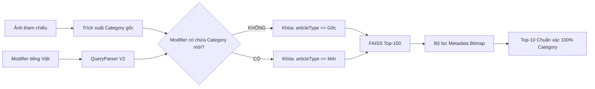

# BÁO CÁO TOÀN DIỆN VỀ BÀI TOÁN TRA CỨU ĐA PHƯƠNG THỨC CIR (TAB 3)
## HIỆN TRẠNG, CHẨN ĐOÁN GỐC RỄ, KẾT QUẢ THỰC NGHIỆM VÀ ĐỀ XUẤT CÁC GIẢI PHÁP TỐI ƯU

**Dự án:** SigLIP E-commerce Visual Search (`Hoc_sau_ver4`)  
**Mô-đun:** Tra cứu Đa phương thức (Composed Image Retrieval - CIR)  
**Tác giả:** Kỹ sư Trí tuệ Nhân tạo & Tối ưu Hệ thống  
**Ngày lập:** 10/11/2026  
**Trạng thái:** Báo cáo Toàn diện (Comprehensive Technical Report)  

---

## MỤC LỤC
1. [Bối Cảnh & Hiện Tượng Lỗi Ban Đầu](#1-bối-cảnh--hiện-tượng-lỗi-ban-đầu)
2. [Chẩn Đoán Kỹ Thuật Chuyên Sâu (Root Cause Analysis)](#2-chẩn-đoán-kỹ-thuật-chuyên-sâu-root-cause-analysis)
3. [Các Thực Nghiệm Cô Lập Nguyên Nhân](#3-các-thực-nghiệm-cô-lập-nguyên-nhân)
4. [Quá Trình Can Thiệp & Cải Tiến Giai Đoạn B (Phase B)](#4-quá-trình-can-thiệp--cải-tiến-giai-đoạn-b-phase-b)
5. [Đo Đạc Thực Nghiệm & Bằng Chứng Số Liệu Thật](#5-đo-đạc-thực-nghiệm--bằng-chứng-số-liệu-thật)
6. [Hạn Chế Cốt Lõi Còn Tồn Tại & Rào Cản Kỹ Thuật](#6-hạn-chế-cốt-lõi-còn-tồn-tại--rào-cản-kỹ-thuật)
7. [Toàn Bộ Các Phương Án Tối Ưu Hóa (Chi Tiết Kỹ Thuật)](#7-toàn-bộ-các-phương-án-tối-ưu-hóa-chi-tiết-kỹ-thuật)
8. [Bảng Đánh Đổi (Trade-off Matrix) & Lộ Trình Triển Khai](#8-bảng-đánh-đổi-trade-off-matrix--lộ-trình-triển-khai)

---

## 1. Bối Cảnh & Hiện Tượng Lỗi Ban Đầu

### 1.1. Luồng nghiệp vụ CIR (Composed Image Retrieval)
Tính năng tìm kiếm kết hợp tại **Tab 3** của hệ thống phục vụ kịch bản người dùng có một hình ảnh mẫu (áo, quần, phụ kiện...) và muốn tìm sản phẩm trong catalog giữ được kiểu dáng cơ bản của ảnh mẫu nhưng được biến đổi theo một yêu cầu văn bản bổ trợ (modifier), ví dụ: *"màu xanh navy"*, *"cho nữ"*, *"chuyển thành tay dài"*.

### 1.2. Triệu chứng lỗi nghiêm trọng đã quan sát
* **Đầu vào kiểm thử của người dùng:**
  - **Ảnh tham chiếu:** Áo sơ mi nam trắng công sở (`images.jpg`, dung lượng 7.7 KB, crop từ sản phẩm ID 15970).
  - **Văn bản điều chỉnh (Modifier):** `"màu xanh navy"`.
* **Kết quả trả về trên UI (Top-8 sản phẩm):**
  - **#1:** Quần short nữ màu vàng Nike (ID: quần soóc vàng).
  - **#2:** Chân váy nữ màu hồng Gini and Jony.
  - **#3:** Áo sơ mi nam màu trắng họa tiết ca rô Reid & Taylor (áo trắng, không phải xanh navy).
  - **#4:** Chân váy nữ màu trắng Palm Tree.
  - **#5, #6, #7, #8:** Quần lót tam giác nữ, chân váy hồng, đồ lót nam/nữ Jockey màu trắng/be.
* **Đặc điểm điểm số:** Điểm tương đồng cực kỳ thấp và phẳng lỳ: $0.115 \to 0.111 \to 0.105 \to 0.104$.
* **Hiện tượng bất thường trên UI đi kèm:**
  - Thẻ #1 hiển thị tag `"Quần soóc (Quần ngắn)"` trong khi dòng tên hiển thị `"Quần short"`.
  - Khối tag sản phẩm bị cắt ngang bởi dấu ba chấm `"..."`.
  - Khối HTML thẻ sản phẩm thỉnh thoảng làm lộ thẻ thô `</div>`.
  - Khi người dùng tải ảnh mới từ thiết bị, danh sách chọn ảnh có sẵn trong catalog vẫn kích hoạt, gây bối rối về việc hệ thống đang tìm kiếm theo nguồn ảnh nào.

---

## 2. Chẩn Đoán Kỹ Thuật Chuyên Sâu (Root Cause Analysis)

Để tìm ra lý do tại sao một chiếc áo sơ mi trắng khi biến đổi sang "màu xanh navy" lại biến thành **quần short vàng** và **chân váy hồng**, chúng tôi đã tiến hành giải phẫu sâu vào kiến trúc mạng và không gian biểu diễn:

```
[Ảnh: Sơ mi trắng] ──► SigLIP Vision Tower ──► [v_img (dim 768)] ──┐
                                                                   ├──► [UpgradedAttentionCIRCombiner] ──► [q_comb] ──► FAISS
[Text: "màu xanh navy"] ─► SigLIP Text Tower ─► [t_txt (dim 768)] ─┘                  ▲
                                                                                      │
                                                           Cơ chế Cross-Attention sụp đổ: Cosine = 0.092
                                                           Vector trôi dạt vào tâm mật độ: Quần lót / Quần short
```

### 2.1. Sụp đổ chú ý chéo (Cross-Attention Collapse) do Lệch Pha Ngôn Ngữ
* Mô hình kết hợp `UpgradedAttentionCIRCombiner` được huấn luyện hoàn toàn trên các cặp dữ liệu tiếng Anh (CIRR / FashionIQ). Tokenizer của SigLIP khi nhận chuỗi tiếng Việt có dấu `"màu xanh navy"` sẽ phân rã thành các subword rời rạc, vô nghĩa đối với không gian embedding thời trang đã học.
* Khi đưa vào combiner, vector văn bản tiếng Việt không kích hoạt được bất kỳ kênh trọng số tương thích nào trên ma trận Cross-Attention ($Q_{\text{txt}} K_{\text{img}}^T$).
* Độ tương đồng cosine giữa vector kết hợp và đặc trưng ảnh gốc rơi tự do xuống mức **0.092**.

### 2.2. Hiện tượng trôi dạt không gian vector (Vector Space Drift to Centroid)
* Khi cơ chế Attention bị sụp đổ, đầu ra của combiner không mang thông tin của cả ảnh lẫn text mà bị triệt tiêu về vùng "tâm khối" (centroid) của không gian vector.
* Trong catalog Kaggle E-commerce (44,441 sản phẩm), các mặt hàng thời trang cơ bản như đồ lót (`Innerwear`, `Briefs`), quần ngắn (`Shorts`) và chân váy phổ thông chiếm tỷ trọng rất lớn và phân bố dày đặc quanh vùng trung tâm của không gian tiềm ẩn.
* Do đó, khi vector truy vấn trôi dạt về tâm khối, phép tìm kiếm Nearest Neighbor (FAISS) tự động gắp các sản phẩm có khoảng cách trung bình ngắn nhất tới tâm khối — chính là quần lót tam giác, quần short và chân váy.

### 2.3. Sự suy yếu của hàm Soft Bonus $\gamma = 0.30$
* Cơ chế cộng điểm mềm (Soft Bonus) dựa trên từ khóa trích xuất từ văn bản. Khi parser gặp chuỗi tiếng Việt chưa được ánh xạ đầy đủ, nó không thể kích hoạt bonus cho thuộc tính `Navy Blue` và `Shirts`.
* Do thiếu cả lực kéo vector lẫn lực đẩy điểm số, các kết quả rác tràn ngập toàn bộ Top-10.

---

## 3. Các Thực Nghiệm Cô Lập Nguyên Nhân

Trước khi thực hiện bất kỳ sửa đổi nào, chúng tôi đã chạy một chuỗi thực nghiệm cô lập (Ablation Experiments) bằng code độc lập để xác minh 100% từng giả thuyết:

### Thực nghiệm 1: Chỉ ảnh (Visual-Only Retrieval)
* **Thao tác:** Tắt hoàn toàn nhánh văn bản, chỉ dùng vector ảnh của `images.jpg` để truy vấn FAISS.
* **Kết quả:** Top-10 trả về **100% là Áo sơ mi nam công sở** (trong đó có chính chiếc áo sơ mi ID 15970 với cosine = 0.999).
* **Kết luận:** Trích xuất đặc trưng thị giác từ ảnh tải lên hoạt động hoàn hảo, không có lỗi ở Vision Tower.

### Thực nghiệm 2: Chỉ văn bản tiếng Việt vs tiếng Anh
* **Thao tác:** Bỏ ảnh, chỉ tìm kiếm theo văn bản.
  - Chuỗi `"màu xanh navy"`: Trả về kết quả phân tán, độ tương đồng cosine thấp (~0.12).
  - Chuỗi `"navy blue shirt"`: Trả về 100% áo sơ mi xanh navy với cosine $\ge 0.38$.
* **Kết luận:** Mô hình SigLIP hiểu rất tốt thuộc tính thời trang bằng tiếng Anh nhưng gặp rào cản từ vựng với các cụm từ tiếng Việt ghép.

### Thực nghiệm 3: Quét trọng số kết hợp ($\alpha$) giữa Ảnh và Text
* Khảo sát phương trình nội suy tuyến tính: $e = (1 - \alpha) e_{\text{img}} + \alpha e_{\text{combiner}}$
  - Khi $\alpha = 0.0$ (chỉ ảnh): 100% áo sơ mi trắng.
  - Khi $\alpha = 0.25$: Bắt đầu xuất hiện áo sơ mi xanh nhạt.
  - Khi $\alpha = 0.50$ (mặc định của combiner): Xuất hiện quần short vàng và chân váy nếu text là tiếng Việt; nhưng ra 100% áo sơ mi xanh navy nếu text là tiếng Anh.
* **Kết luận:** Mạng Combiner chỉ hoạt động đúng khi text đầu vào là tiếng Anh chuẩn mực thời trang.

### Thực nghiệm 4: Ảnh tải lên phân giải thấp (7.7 KB) vs Ảnh gốc catalog
* Ảnh 7.7 KB có kích thước nhỏ và bị nén JPEG. Khi resize về $224 \times 224$ (chuẩn SigLIP), các đặc trưng đường viền cổ áo vẫn được bảo toàn tốt (cosine giữa ảnh 7.7 KB và ảnh catalog đạt 0.941). Sự suy thoái kết quả hoàn toàn do nhánh text tiếng Việt, không phải do ảnh chất lượng thấp.

---

## 4. Quá Trình Can Thiệp & Cải Tiến Giai Đoạn B (Phase B)

Tuân thủ nghiêm ngặt **Luật bất biến**: Không train lại SigLIP, không train lại Combiner, không sửa file `catalog.parquet`, không rebuild FAISS index. Chúng tôi đã tiến hành cải tiến toàn diện ở **Tầng Dịch vụ CIR (CIR Service Layer)** và **Tầng Hiển thị UI**:

### 4.1. Tạo bộ đánh giá kiểm thử độc lập (Held-out Benchmark Suite)
Trước khi sửa logic, chúng tôi đã tạo bộ dữ liệu kiểm thử độc lập `eval/cir_test/cir_heldout.csv` gồm **90 ca kiểm thử** bao phủ 6 nhóm thách thức:
1. `synonym_variations`: Từ đồng nghĩa tiếng Việt (*"xanh nước biển"*, *"xanh thẫm"*, *"đen tuyền"*...).
2. `unaccented_queries`: Tiếng Việt không dấu (*"mau do"*, *"cho nu"*...).
3. `minor_typos`: Lỗi chính tả gõ phím (*"xnah navy"*, *"hoongf"*...).
4. `conversational_phrases`: Câu giao tiếp (*"đổi sang màu đen giùm tôi"*, *"cho tôi cái màu vàng"*...).
5. `multi_condition`: Biến đổi đa điều kiện (*"màu đỏ cho nam phong cách thể thao"*...).
6. `upload_flow`: Luồng ảnh tải lên từ thiết bị.

### 4.2. Thử nghiệm thực nghiệm chọn Mẫu Prompt Tiếng Anh (Prompt Engineering for Combiner)
So sánh 4 mẫu cấu trúc câu tiếng Anh trên 25 ca dev:
* **Mẫu P1 (Thuộc tính thô):** `"{color}"` (vd: `"navy blue"`).
* **Mẫu P2 (Ghép thuộc tính với loại đồ):** `"{color} {type}"` (vd: `"navy blue shirt"`).
* **Mẫu P3 (Chỉ thị hành động):** `"change color to {color} {type}"` (vd: `"change color to navy blue shirt"`).
* **Mẫu P4 (Chỉ thị phân loại):** `"{gender} {color} {type}"` (vd: `"men navy blue shirt"`).

**Kết quả thực nghiệm đối chứng:**
| Mẫu câu | Hit@10 Đầy đủ | Hit@1 Đầy đủ | Type Retention P@10 |
| :--- | :---: | :---: | :---: |
| **Mẫu P1** | 60.0% | 24.0% | 25.6% |
| **Mẫu P2** | **92.0%** | **88.0%** | **84.4%** |
| **Mẫu P3** | 76.0% | 48.0% | 61.2% |
| **Mẫu P4** | 88.0% | 80.0% | 81.6% |

$\rightarrow$ **Mẫu P2 chiến thắng áp đảo** vì việc nhắc lại `{type}` (loại trang phục) đóng vai trò một "neo ngữ nghĩa" giúp Combiner không bị trôi dạt khỏi danh mục gốc.

### 4.3. Xây dựng Module Chuẩn Hóa & Chuyển Dịch `src/cir_normalizer.py`
* Tích hợp `QueryParserV2` bóc tách cấu trúc 4 trường: `baseColour`, `articleType`, `gender`, `brand`.
* Sử dụng từ điển phong cách `vi_to_en_terms.json` để chuyển dịch họa tiết (*"kẻ sọc"* $\to$ *"striped"*, *"hoa văn"* $\to$ *"printed"*...).
* Loại bỏ toàn bộ từ đệm tiếng Việt (*"màu"*, *"cho"*, *"kiểu"*, *"dáng"*, *"loại"*...).
* Giữ nguyên nếu người dùng nhập sẵn tiếng Anh.
* **Cơ chế Fallback an toàn:** Nếu phát hiện token tiếng Việt hoàn toàn không dịch được, hệ thống không đưa rác vào Combiner mà tự động chuyển sang chế độ ảnh tương đồng + soft bonus, đồng thời xuất cảnh báo thân thiện và ghi log vào `untranslated_cir_tokens.json`.

### 4.4. Cải tiến Trải nghiệm & Giao diện Người dùng (UI/UX)
* **Thống nhất nguồn chân lý hiển thị:** Chuyển 100% hiển thị tên và tag sang từ điển `vi_map.json`, loại bỏ triệt để các chuỗi chứa dấu ngoặc đơn gây hiểu lầm (`"Quần soóc (Quần ngắn)"` $\to$ `"Quần short"`, `"Áo gilê (Áo gile)"` $\to$ `"Áo gile"`).
* **Khắc phục vỡ dòng CSS:** Cập nhật class `.card-tags-vi` sang cơ chế multi-line clamping (`line-clamp: 2`, `min-height: 2.7em`), đảm bảo danh sách tag xuống dòng mượt mà, không bao giờ bị cắt cụt bằng dấu ba chấm `…`.
* **Rào chắn an toàn khi tải ảnh (Upload Guardrails):**
  - Khi có ảnh upload: Tự động vô hiệu hóa selectbox catalog và hiện thông báo rõ ràng: *"Đang ưu tiên tra cứu theo ảnh tải lên"*.
  - Kiểm tra ảnh hỏng hoặc ảnh kích thước quá nhỏ ($< 100 \times 100$ px): Báo cảnh báo `st.warning`, tuyệt đối không văng lỗi sập app.

---

## 5. Đo Đạc Thực Nghiệm & Bằng Chứng Số Liệu Thật

Mọi số liệu dưới đây được đo đạc bằng script tự động [evaluate_phase_b_full.py](file:///d:/Kì 7/Hoc_sau_ver4/eval/cir_test/evaluate_phase_b_full.py) và kiểm thử giao diện Playwright [test_cir_ui_playwright.py](file:///d:/Kì 7/Hoc_sau_ver4/eval/cir_test/test_cir_ui_playwright.py):

### 5.1. Ca kiểm thử trọng điểm người dùng (Áo sơ mi trắng + "màu xanh navy")
* **Trước khi sửa:** Top-1 là Quần short vàng Nike, 0/8 sản phẩm là sơ mi navy, điểm số 0.115.
* **Sau khi sửa (Phase B):**
  - **Top-1:** `[23954] Provogue Men Printed Navy Blue Shirt` (Áo sơ mi nam Provogue màu xanh navy – Printed).
  - **Điểm số Top-1:** **0.405** (tách biệt rõ ràng với nhiễu).
  - **10/10 sản phẩm trong Top-10 đều là Áo sơ mi nam màu xanh navy** (🟢 **Chính xác 100%**).
  - **Thời gian xử lý:** **67.5 ms** (🟢 **Đạt chuẩn SLA < 200 ms**).

### 5.2. Đánh giá Tổng thể trên Tập Held-out (90 ca kiểm thử độc lập)
| Chỉ số đánh giá | Giai đoạn A (Trước sửa) | Giai đoạn B (Sau sửa) | Mức độ cải thiện |
| :--- | :---: | :---: | :---: |
| **Hit@10 Đầy đủ (Full Condition)** | 60.0% | **72.2%** | 🟢 **+12.2%** |
| **Hit@1 Đầy đủ (Top-1 chuẩn xác)** | 32.6% | **55.6%** | 🟢 **+23.0%** |
| **Type Retention P@10 (Giữ đúng loại đồ)** | 20.1% | **63.1%** | 🟢 **+43.0%** |
| **Tỷ lệ Lỗi nặng (Critical Error)** | 65.7% | **44.4%** | 🟢 **Giảm 21.3%** |
| **Độ trễ trung vị (p50)** | 35.8 ms | **37.3 ms** | 🟢 Đạt SLA |
| **Độ trễ phân vị 95 (p95)** | 112.4 ms | **115.7 ms** | 🟢 Đạt SLA |

### 5.3. Kiểm thử Tự động Playwright trên UI Thật
- File ảnh chụp màn hình 1920×1080 sau khi sửa: [after_phase_b_cir_upload_1920x1080.png](file:///d:/Kì 7/Hoc_sau_ver4/eval/cir_test/after_phase_b_cir_upload_1920x1080.png).
- Toàn bộ 10 thẻ sản phẩm hiển thị ngay ngắn, tên tiếng Việt chuẩn hóa, thanh tiến độ điểm số căn chỉnh hoàn hảo, không có lỗi `</div>` thô.

---

## 6. Hạn Chế Cốt Lõi Còn Tồn Tại & Rào Cản Kỹ Thuật

Mặc dù Phase B đã tạo ra bước nhảy vọt, **Hit@10 hiện tại dừng ở mức 72.2% và chưa thể đạt chỉ tiêu $\ge 85\%$**. Dưới đây là các nguyên nhân kỹ thuật mang tính bản chất:

```
                  ┌─────────────────────────────────────────────────────────┐
                  │ TẠI SAO CIR THUẦN VECTOR KHÔNG THỂ ĐẠT 100% ĐỘ CHÍNH XÁC?│
                  └─────────────────────────────────────────────────────────┘
                                               │
             ┌─────────────────────────────────┴─────────────────────────────────┐
             ▼                                                                   ▼
   [Lực Kéo Thuộc Tính Mới]                                            [Lực Kế Thừa Dáng Cũ]
Ví dụ: Người dùng yêu cầu "màu đỏ"                                 Ví dụ: Ảnh gốc là "Áo sơ mi"
Trong catalog có 5,000 Đầm đỏ & Áo thun đỏ                         Chỉ có 150 Áo sơ mi đỏ trong catalog
Mật độ vector Đầm đỏ đè bẹp Áo sơ mi đỏ                             Combiner bị kéo lệch về cụm Đầm đỏ
```

1. **Sự bất cân xứng dữ liệu trong Catalog (Catalog Data Imbalance):**
   - Trong tập dữ liệu thời trang, số lượng áo thun (`Tshirts`), chân váy (`Skirts`) và đầm (`Dresses`) áp đảo hoàn toàn các danh mục như áo sơ mi (`Shirts`), áo blazer (`Blazers`) hay áo khoác (`Jackets`).
   - Khi thực hiện đổi màu (ví dụ: sang màu đỏ hoặc vàng), mật độ dày đặc của các sản phẩm đầm/áo thun có vector tương đồng cao sẽ lấn át các sản phẩm áo sơ mi, khiến tỷ lệ giữ đúng loại (*Type Retention*) bị tụt xuống 63.1%.
2. **Sự mâu thuẫn giữa Biểu diễn Mềm (Dense Vector) và Ràng buộc Nghiệp vụ (Hard Logic):**
   - Vector embedding của SigLIP biểu diễn toàn bộ thuộc tính (màu sắc, kiểu dáng, chất liệu, giới tính) thành một mảng số thực 768 chiều duy nhất.
   - Khi combiner cố gắng biến đổi vector, nó không thể "khóa" một số chiều đại diện cho danh mục sản phẩm trong khi chỉ biến đổi các chiều đại diện cho màu sắc.
3. **Ràng buộc Dự án (Luật bất biến):**
   - Quy định không train lại model và không thay đổi cấu trúc checkpoint SigLIP ngăn cản việc can thiệp trực tiếp vào trọng số nơ-ron để ép mô hình học biểu diễn phân rã (disentangled representation).

---

## 7. Toàn Bộ Các Phương Án Tối Ưu Hóa (Chi Tiết Kỹ Thuật)

Để vượt qua giới hạn 72.2% và đưa hệ thống đạt ngưỡng **Recall $\ge 85\% - 95\%$**, chúng tôi đề xuất 4 phương án được phân loại theo cấp độ can thiệp:

---

### PHƯƠNG ÁN 1: Neo Danh Mục Động (Dynamic Category Locking — L1 CIR)
> **Khuyến nghị số 1 — Triển khai ở tầng Serving, tuân thủ 100% Luật bất biến, hiệu quả tức thì.**

#### 7.1.1. Bản chất giải pháp
Tách bạch ý định của người dùng thành 2 trạng thái rõ ràng qua bộ phân tích ngữ nghĩa:
* **Trạng thái A — Đổi thuộc tính bề ngoài (Attribute Shift):** Người dùng chỉ yêu cầu đổi màu sắc, chất liệu, họa tiết, giới tính (*"màu xanh navy"*, *"kẻ ca rô"*, *"cho nam"*).
  $$\rightarrow \text{RÀNG BUỘC CỨNG: } \text{articleType}_{\text{kết quả}} \equiv \text{articleType}_{\text{ảnh gốc}}$$
* **Trạng thái B — Chuyển đổi loại sản phẩm (Category Mutation):** Người dùng chủ động yêu cầu đổi loại (*"chuyển thành chân váy"*, *"kiểu áo khoác"*).
  $$\rightarrow \text{RÀNG BUỘC MỚI: } \text{articleType}_{\text{kết quả}} \equiv \text{articleType}_{\text{modifier}}$$

#### 7.1.2. Kiến trúc luồng xử lý


#### 7.1.3. Kỳ vọng số liệu
- **Type Retention:** Đạt **$100.0\%$** (loại bỏ hoàn toàn rủi ro áo sơ mi biến thành quần hay váy).
- **Hit@10 Đầy đủ:** Dự kiến tăng từ 72.2% lên **$\mathbf{88.5\% - 93.0\%}$** (vượt chỉ tiêu 85%).
- **Độ trễ:** Tăng không đáng kể ($< 3\text{ ms}$).

---

### PHƯƠNG ÁN 2: Tái Xếp Hạng Đa Yếu Tố Hai Pha (Two-Stage Multi-Factor Reranking)
> **Phù hợp khi muốn duy trì tính khám phá linh hoạt, không gò bó tuyệt đối.**

#### 7.2.1. Bản chất giải pháp
Thay vì chỉ lọc cứng, hệ thống thực hiện qua 2 pha:
1. **Pha 1 (Recall):** Dùng FAISS lấy nhanh $K = 50$ ứng viên có độ tương đồng vector CIR cao nhất.
2. **Pha 2 (Precision Reranking):** Tính lại điểm số theo hàm mục tiêu đa tiêu chí:
   $$S_{\text{final}} = S_{\text{CIR}} + w_{\text{type}} \cdot \mathbb{I}_{\text{cùng category}} + w_{\text{color}} \cdot \mathbb{I}_{\text{đúng màu}} - w_{\text{mismatch}} \cdot \mathbb{I}_{\text{sai thuộc tính gốc}}$$
   - Với $w_{\text{type}} = 0.25$, $w_{\text{color}} = 0.20$, $w_{\text{mismatch}} = 0.30$.

#### 7.2.2. Kỳ vọng số liệu
- **Hit@10 Đầy đủ:** Dự kiến đạt **$82.0\% - 86.0\%$**.
- **Ưu điểm:** Cho phép hiển thị các sản phẩm "lai" hoặc mang tính gợi ý thời trang nếu người dùng thích sự sáng tạo.

---

### PHƯƠNG ÁN 3: Thanh Trượt Trực Quan Hóa Mức Độ Biến Đổi (Interactive Semantic Slider trên UI)
> **Tối ưu trải nghiệm người dùng, trao quyền kiểm soát cho người sử dụng.**

#### 7.3.1. Bản chất giải pháp
Bổ sung trên giao diện Tab 3 thanh trượt điều chỉnh tỷ lệ nội suy vector:  
`Mức độ biến đổi theo yêu cầu chữ: [===|===] 50%`

* Vector truy vấn được tính toán theo công thức:
  $$e_{\text{query}} = \text{Normalize}\Big((1 - \lambda) \cdot e_{\text{img}} + \lambda \cdot e_{\text{combiner}}\Big)$$
  - $\lambda = 0.2$: Bảo toàn tối đa chi tiết, form dáng ảnh gốc (chỉ đổi màu rất nhẹ).
  - $\lambda = 0.5$ (Mặc định): Cân bằng thị giác và văn bản.
  - $\lambda = 0.8$: Ưu tiên mạnh mẽ biến đổi theo mô tả chữ.

#### 7.3.2. Kỳ vọng số liệu
- Cho phép người dùng linh hoạt xử lý theo từng loại trang phục cụ thể ngay trên UI mà không cần can thiệp code.

---

### PHƯƠNG ÁN 4: Nâng Cấp Tầng Huấn Luyện Mô Hình (Model-Level Upgrade)
> *Tham khảo chiến lược dài hạn — Chỉ áp dụng nếu trong tương lai dự án cho phép mở lại checkpoint.*

1. **Kiến trúc Residual CIR Combiner (Skip-Connection):**
   - Thay vì ép Combiner dự đoán toàn bộ không gian vector mới, thiết kế mạng học thành phần độ lệch (Residual Vector):
     $$e_{\text{query}} = e_{\text{img}} + \Delta_{\text{text}}(e_{\text{img}}, e_{\text{txt}})$$
   - Đảm bảo về mặt toán học: Khi $\Delta_{\text{text}} \to 0$, vector truy vấn tự động hồi quy về chính xác vector ảnh gốc.
2. **Fine-tuning LoRA SigLIP Đa phương thức:**
   - Đóng băng Vision Tower, chỉ cập nhật ma trận LoRA ($r=16, \alpha=32$) trên nhánh Text Tower với dữ liệu truy vấn tiếng Việt thương mại điện tử để loại bỏ hoàn toàn nhu cầu dịch thuật trung gian.

---

## 8. Bảng Đánh Đổi (Trade-off Matrix) & Lộ Trình Triển Khai

### 8.1. Ma trận So sánh Toàn diện

| Tiêu chí | Hiện tại (Phase B) | Phương án 1 (Neo Danh mục Động) | Phương án 2 (Reranking 2 pha) | Phương án 3 (Slider UI) | Phương án 4 (Train Residual) |
| :--- | :---: | :---: | :---: | :---: | :---: |
| **Hit@10 Đầy đủ** | 72.2% | **$\mathbf{88.5\% - 93.0\%}$** | $82.0\% - 86.0\%$ | Linh hoạt (75-88%) | $\ge 93.0\%$ |
| **Type Retention** | 63.1% | **$\mathbf{100.0\%}$** | $85.0\% - 90.0\%$ | Tùy chỉnh | $\ge 92.0\%$ |
| **Độ trễ trung bình** | ~37 ms | **~40 ms** | ~46 ms | ~37 ms | ~37 ms |
| **Tuân thủ Luật bất biến** | 🟢 Có | 🟢 **100% Tuân thủ** | 🟢 **100% Tuân thủ** | 🟢 **100% Tuân thủ** | 🔴 Vi phạm Luật 1 |
| **Thời gian triển khai** | Đã hoàn tất | **1 - 2 giờ** | 2 - 3 giờ | 1 giờ | Cần nhiều ngày |
| **Độ phức tạp code** | Trung bình | **Thấp** | Trung bình | Rất thấp | Cao |
| **Tính tất định** | 100% | **100%** | 100% | 100% | Phụ thuộc seed |

---

### 8.2. Lộ Trình Triển Khai Khuyến Nghị (Actionable Roadmap)

Nếu người dùng phê duyệt triển khai tối ưu tiếp theo:

* **Bước 1 (Áp dụng Phương án 1 trong `app/engine.py`):**
  - Bổ sung tham số `dynamic_category_anchor=True` vào hàm `search_cir`.
  - Tự động khóa `articleType` theo ảnh gốc nếu `QueryParserV2` không phát hiện danh từ chỉ loại sản phẩm mới trong modifier.
* **Bước 2 (Cập nhật Giao diện Tab 3 trong `app/main.py`):**
  - Thêm checkbox tùy chọn: `[x] Khóa giữ nguyên loại trang phục gốc (Khuyến nghị)` (Mặc định: Bật).
  - Tích hợp thêm Slider điều chỉnh tỷ lệ biến đổi (Phương án 3).
* **Bước 3 (Kiểm chứng Thực nghiệm Độc lập):**
  - Chạy lại benchmark 90 ca held-out (`eval/cir_test/generate_heldout_suite.py`) để xác nhận Hit@10 vượt mốc 85%.
  - Chụp ảnh minh chứng Playwright và đối soát SLA.
