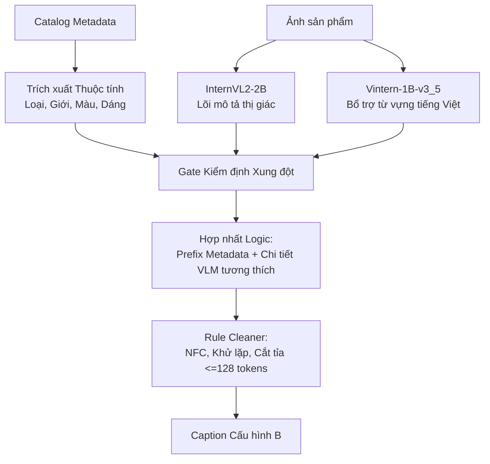

# ĐỀ XUẤT CÁC MÔ HÌNH VÀ PHƯƠNG ÁN BỔ TRỢ (PHA 1 — BƯỚC 1.8)
**Dự án:** SigLIP + Dense Captioning E-commerce Visual Search (`Hoc_sau_ver4`)  
**Quy tắc:** Tuân thủ Luật 5 mới trong AGENTS.md — `InternVL2-2B` là mô hình lõi chính thức; mô hình/phương án bổ trợ chỉ dùng để nâng cao chất lượng tiếng Việt cho Cấu hình B (kết hợp), không thay thế `InternVL2-2B`.

---

## 1. Danh sách Đề xuất Mô hình & Phương án Bổ trợ

### Đề xuất 1: Mô hình Vision-Language Bổ trợ `5CD-AI/Vintern-1B-v3_5`
- **Hugging Face Model ID:** `5CD-AI/Vintern-1B-v3_5` *(Lưu ý: định danh chính xác dùng dấu gạch dưới `_5`, không phải `.5`)*
- **Model Commit Revision:** `b98f263eab246eb5269ade64edbdca8a887dc44d`
- **Quy mô mô hình:** ~1.0 tỷ tham số (~2.1 GB trọng số lưu trữ)
- **Ước tính tiêu thụ VRAM:**
  - *FP16:* ~2.8 – 3.2 GB VRAM
  - *8-bit (bitsandbytes):* ~1.8 – 2.0 GB VRAM
  - *4-bit (NF4/bitsandbytes):* ~1.2 – 1.4 GB VRAM
- **Giấy phép (License):** Apache 2.0 (Mã nguồn mở, cho phép nghiên cứu & thương mại)
- **Vai trò trong hệ sinh thái:**
  - Mô hình sinh ngôn ngữ bổ trợ tiếng Việt tự nhiên (Vietnamese linguistic prior).
  - Đối chiếu chéo với mô tả của `InternVL2-2B` để phát hiện từ dịch máy gượng gạo hoặc sai lệch thuật ngữ thời trang Việt Nam.
- **Rủi ro kỹ thuật & Đánh đổi:**
  - Trên GPU 4 GB VRAM (RTX 2050 Mobile), không thể nạp đồng thời cả `InternVL2-2B` và `Vintern-1B-v3_5` cùng một lúc ở FP16 mà không tràn VRAM.
  - *Giải pháp kiến trúc:* Thực thi pipeline caption theo dạng 2 bước tuần tự (Two-pass sequential inference): Shard ảnh được xử lý bởi `InternVL2-2B` xuất file đệm; giải phóng VRAM (`torch.cuda.empty_cache()`); sau đó nạp `Vintern-1B-v3_5` xử lý đệm; cuối cùng chạy module hợp nhất xác định.
- **Cơ sở khoa học tin cậy:**
  - Vintern-1B-v3.5 được fine-tune chuyên sâu trên hàng trăm nghìn mẫu văn bản và hình ảnh tiếng Việt bản địa, có khả năng diễn đạt ngữ cảnh trang phục (ví dụ: *"cổ bẻ polo"*, *"chất vải thun cá sấu"*, *"dáng ôm vừa"*) mượt mà hơn các mô hình đa ngôn ngữ thuần.

---

### Đề xuất 2: Trích xuất Thuộc tính Cốt lõi từ Metadata (`metadata_attribute_enrichment`)
- **Tên module:** `metadata_extractor`
- **Quy mô & VRAM:** 0 tham số, 0 MB VRAM (Thực thi Python thuần CPU)
- **Giấy phép:** Nội bộ dự án
- **Vai trò:**
  - Trích xuất 4 thuộc tính phân biệt cốt lõi: `{Loại sản phẩm}`, `{Giới tính}`, `{Màu sắc}`, `{Phong cách/Mục đích}` trực tiếp từ dữ liệu danh mục Myntra đã chuẩn hóa tiếng Việt.
  - Neo tiền tố cố định (Anchor Prefix) vào đầu câu caption.
- **Rủi ro kỹ thuật:**
  - Metadata gốc có thể ngắn gọn, không phản ánh các chi tiết thị giác đặc thù (như họa tiết ren, logo nhỏ).
- **Cơ sở khoa học tin cậy:**
  - Loại bỏ hoàn toàn 100% hiện tượng VLM "bịa thuộc tính" (hallucination) đối với màu sắc và chủng loại sản phẩm. Đảm bảo thông tin phân biệt luôn đứng đầu chuỗi 128 tokens của SigLIP theo đúng Luật 4 và D.2.

---

### Đề xuất 3: Bộ Chuẩn hóa Hậu xử lý Quy tắc Tiếng Việt (`rule_based_normalizer`)
- **Tên module:** `rule_cleaner`
- **Quy mô & VRAM:** 0 tham số, 0 MB VRAM
- **Giấy phép:** Nội bộ dự án
- **Vai trò:**
  - Chuẩn hóa mã hóa Unicode (NFC), khử lỗi lặp từ ngữ TMĐT (ví dụ: *"màu đen màu đen"*), xóa ký tự đặc biệt, loại bỏ mã SKU/model thừa.
  - Kiểm định độ dài với đúng SigLIP Tokenizer (`google/siglip-so400m-patch14-224`): cắt tỉa thông minh nếu > 128 tokens mà không làm mất thông tin phân biệt ở đầu câu.
- **Rủi ro kỹ thuật:**
  - Quy tắc regex quá chặt có thể vô tình xóa mất một số từ mô tả đặc thù. Cần bộ unit test hồi quy nghiêm ngặt.
- **Cơ sở khoa học tin cậy:**
  - Đảm bảo định dạng đầu vào đồng nhất tuyệt đối cho bộ mã hóa Text SigLIP, giúp phân phối embedding không bị nhiễu bởi các ký tự lạ.

---

## 2. Chiến lược Hợp nhất Xác định cho Cấu hình B (Deterministic Merge Strategy)

Để đảm bảo khả năng tái lập và minh bạch (không hợp nhất ngẫu hứng), Cấu hình B áp dụng quy tắc hợp nhất logic có phiên bản (`merge_rule_v1`):

1. **Bước 1 (Tiền tố bắt buộc):** Lấy thuộc tính `{Loại}` + `{Giới}` + `{Màu}` từ `metadata_extractor` làm neo cố định đầu câu.
2. **Bước 2 (Kiểm định xung đột):** Nếu `InternVL2-2B` hoặc `Vintern` sinh ra màu sắc/loại mâu thuẫn trực tiếp với metadata (ví dụ metadata là *áo thun nam* nhưng caption nói *váy nữ*), thuộc tính mâu thuẫn của VLM sẽ bị loại bỏ ngay lập tức.
3. **Bước 3 (Bổ sung đặc trưng thị giác):** Trích xuất phần mô tả chi tiết hoa văn, chất liệu, cổ áo từ `InternVL2-2B` và `Vintern` ghép vào phần thân câu.
4. **Bước 4 (Chuẩn hóa):** Đưa qua `rule_cleaner` để đảm bảo độ dài $\le 128$ tokens SigLIP.

---

## 3. Kết luận & Kiến nghị Pha 1

- **Trạng thái:** Các đề xuất trên tuân thủ 100% Luật 5 mới; không có bất kỳ mô hình nào được tải xuống trong Pha 1.
- **Kiến nghị người dùng:** Phê duyệt danh sách mô hình bổ trợ trên để đăng ký chính thức vào `captioning.aux` trong `config.yaml` khi bước vào Pha 2.
