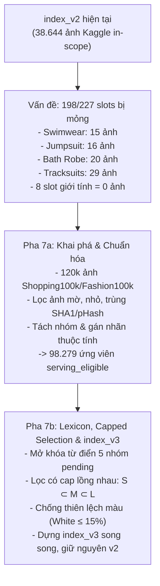
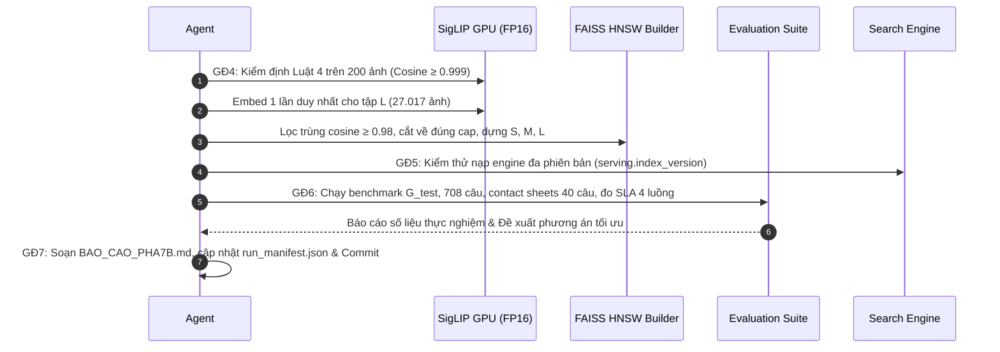

# BÁO CÁO BỐI CẢNH TỔNG QUAN PHA 7 (PHASE 7 OVERVIEW CONTEXT)
**Dự án**: SigLIP E-commerce Visual Search (`Hoc_sau_ver4`)  
**Nhánh Git**: `phase7b_index_v3` (HEAD: `aec6d8b`)  
**Thời điểm ghi nhận**: 11/11/2026  
**Quy tắc bất biến**: Tuân thủ nghiêm ngặt `.agents/AGENTS.md` (Luật 1: Không train/sửa checkpoint; Luật 3: Không ghi đè `index_v2/`; Luật 4: Tiền xử lý khớp train; Luật 7: Manifest khớp checkpoint_hash; Seed 42).

---

## 1. Mục Tiêu & Vấn Đề Cần Giải Quyết Của Pha 7

### Mục tiêu kỹ thuật cốt lõi:
1. **Lấp đầy các slot mỏng (Thin Slots)**: Mở rộng kho ảnh từ các tập ngoài (`Shopping100k`, `Fashion-100k`, `Tiki/Shopee`) để khắc phục tình trạng thiếu hụt trầm trọng của các nhóm sản phẩm thời trang thiết yếu.
2. **Bảo toàn chất lượng và zero-regression**: Tuyệt đối không làm suy giảm độ chính xác của các truy vấn hiện hữu trên `index_v2` (Recall@10 $\ge 0.85$, mAP $\ge 0.75$, Latency p95 $< 200$ ms).
3. **Phân lập hoàn toàn**: `index_v2` và `catalog.parquet` hiện hành là bất biến; chỉ dựng các index mới ở thư mục riêng (`index_v3_S`, `index_v3_M`, `index_v3_L`) và giữ mặc định phục vụ `serving.index_version: "v2"`.

---

## 2. Tổng Hợp Kết Quả Pha 7a (Kiểm Kê, Thanh Lọc & Chuẩn Hóa Schema)

Pha 7a đã xử lý toàn bộ kho ảnh ứng viên khổng lồ qua 5 giai đoạn nghiêm ngặt:

| Giai đoạn | Nhiệm vụ chính | Kết quả đạt được |
| :--- | :--- | :--- |
| **GĐ1 (Inventory)** | Kiểm kê toàn bộ nguồn ảnh ngoài | 120.463 ứng viên từ Shopping100k, Fashion-100k, Tiki, Shopee. |
| **GĐ2 (Quality Gate)** | Thanh lọc chất lượng ảnh | Loại ảnh mờ (Laplacian variance $< 100$), ảnh nhỏ (cạnh ngắn $< 224$), tỷ lệ dị dạng. |
| **GĐ3 (Dedup)** | Lọc trùng nội bộ & tương đồng v2 | Khử trùng SHA-1 và pHash ($d_{\text{pHash}} \le 4$). Bảo vệ độc lập 1.471 ảnh `legacy_test`. |
| **GĐ4 (Schema Mapping)** | Tách nhóm nhập nhằng & đo pixel color | Tách các cụm `shirts_tops`, `6_Jumpers`, `10_Swimming`. Phân định màu bằng khoảng cách Lab centroids. Gán nhãn độ tin cậy `cat_conf`, `gender_conf`, `color_conf`. |
| **GĐ5 (Catalog Export)** | Xuất kho ứng viên chuẩn | Xuất `data/catalog/candidates_v3.parquet` gồm **98.289 ứng viên** (98.279 `serving_eligible=True`). Phát hiện thiên lệch màu nặng trong Shopping100k (Black, Blue, White chiếm 84.48%). |

---

## 3. Tiến Độ & Kết Quả Thực Thi Pha 7b (Đến Thời Điểm Hiện Tại)

Nhánh làm việc: [`phase7b_index_v3`](file:///C:/Users/nguye/.gemini/antigravity/worktrees/Hoc_sau_ver4/phase7b_index_v3/).

### GĐ1 — Sửa Tồn Đọng Pha 7a (Commit `de74742` - Đã xong)
1. **Đối chiếu Dense Captions**: Sửa lỗi lệch tiền tố `shop100k_` ở Pha 7a; tìm lại khóa ghép thành công cho **1.562 / 1.562 (100%)** ảnh `eval_ext_eligible` (94 fashion + 1.468 shopping100k). Xuất bảng đối chiếu [`eval/phase7/eval_ext_dense_captions.csv`](file:///C:/Users/nguye/.gemini/antigravity/worktrees/Hoc_sau_ver4/phase7b_index_v3/eval/phase7/eval_ext_dense_captions.csv).
2. **Đính chính Báo cáo 7a**: Chỉnh sửa mục 4 [`reports/phase7/BAO_CAO_PHA7A.md`](file:///C:/Users/nguye/.gemini/antigravity/worktrees/Hoc_sau_ver4/phase7b_index_v3/reports/phase7/BAO_CAO_PHA7A.md) khớp chính xác với Bảng 4a (Black: 10.777; Blue+Navy: 13.200; White: 3.987; chiếm 84.48%).
3. **Sửa lỗi fixture Pytest**: Thêm session fixture `service` tại [`eval/cir_test/conftest.py`](file:///C:/Users/nguye/.gemini/antigravity/worktrees/Hoc_sau_ver4/phase7b_index_v3/eval/cir_test/conftest.py), toàn bộ 15/15 tests toàn repo chạy xanh.

---

### GĐ2 — Mở Khóa Lexicon 5 Nhóm & Hồi Quy (Commit `cf5b9bc` - Đã xong)
Đã mở khóa từ khóa tiếng Việt (có dấu và không dấu) cho 5 nhóm `pending_lexicon` trong [`src/lexicon_vi.json`](file:///C:/Users/nguye/.gemini/antigravity/worktrees/Hoc_sau_ver4/phase7b_index_v3/src/lexicon_vi.json):
- **Swimwear** (18 từ khóa): đồ bơi, bikini, áo tắm, đồ tắm, áo bơi, quần bơi, đồ bơi một mảnh/hai mảnh/liền thân, monokini, swimwear, swimsuit(s), bộ đồ bơi, set đồ bơi, swimming trunks, swim trunks, speedo.
- **Jumpsuit** (16 từ khóa): jumpsuit, jump suit, jumpsuits, áo liền quần, bộ áo liền quần, bộ jumpsuit, đồ bay, bộ đồ bay, set jumpsuit/jump, playsuit, romper, quần liền áo, bộ liền thân, áo liền quần jumpsuit, bộ liền quần.
- **Bath Robe** (9 từ khóa): áo choàng tắm, áo choàng ngủ, áo choàng tắm khách sạn, áo choàng bông, bathrobe, bath robe, bathrobes, áo choàng bath robe, áo choàng mặc ở nhà.
- **Tracksuits** (16 từ khóa): bộ đồ thể thao, bộ thể thao, bộ nỉ thể thao, set đồ thể thao, set thể thao, bộ quần áo thể thao, tracksuit(s), bộ đồ thể dục, bộ thể dục, bộ quần áo thể dục, bộ nỉ, set nỉ, set đồ nỉ, bộ tập gym, set đồ tập thể thao.
- **Track Pants** (15 từ khóa): giữ 7 từ khóa cũ + bổ sung: tracksuit bottoms/bottom, quần track pants, quần bo gấu, quần nỉ bo gấu, sweatpants/sweat pants, quần ống bo.

**Kết quả kiểm tra hồi quy đóng băng trên 870 câu truy vấn (`index_v2`)**:
- `handwritten_100` (100 câu): Top-1 thay đổi: 0; Top-10 thay đổi: 0 (delta = 0.0000).
- `unseen_32` (32 câu): Top-1 thay đổi: 0; Top-10 thay đổi: 0 (delta = 0.0000).
- `heldout_30` (30 câu): Top-1 thay đổi: 0; Top-10 thay đổi: 0 (delta = 0.0000).
- `708_queries` (708 câu): 705 câu giữ nguyên 100%; 2 câu cải thiện Top-1 (`Q_A_0073` bộ quần áo thể thao AP@10: 0.25 $\rightarrow$ 1.00; `Q_A_0078` áo choàng tắm AP@10: 0.25 $\rightarrow$ 1.00); 1 câu hoán đổi vị trí tương đồng (`Q_F_0605` đồ bơi đi biển). Toàn bộ chỉ số không giảm (P@10 tăng +0.0014, AP@10 tăng +0.0021).
- Thêm unit test parser [`tests/test_phase7b_gd2_parser.py`](file:///C:/Users/nguye/.gemini/antigravity/worktrees/Hoc_sau_ver4/phase7b_index_v3/tests/test_phase7b_gd2_parser.py) (6/6 tests passed).

---

### GĐ3 — Chính Sách Chọn Lọc Có Cap & Đảm Bảo Tính Lồng Nhau (Commit `aec6d8b` - Đã xong)

Định nghĩa phân bậc ứng viên:
- **T1** (39.208 ảnh): Loại + giới + màu đáng tin cậy (`attr_confidence=high` hoặc thuộc 5 nhóm đã mở khóa có `color_conf=high`). Giữ nguyên nhãn màu gốc.
- **T2** (29.255 ảnh): Loại và giới đáng tin cậy nhưng màu không tin cậy (`color_conf=low` hoặc thiếu). Gán `baseColour="Unknown"` trong mảng thuộc tính, không thưởng/phạt màu, title hiển thị không có màu.
- **T3** (12.162 ảnh): Nhóm ngoài schema hoặc loại mơ hồ (`Tops/Shirts-ambiguous`, `Coats`, `cat_conf=low`). Chỉ dùng thử nghiệm dense-only cho Option L.
- **Excluded** (17.664 ảnh): Loại ngoài schema không thuộc T3 hoặc thiếu độ tin cậy.

#### Bảng tổng hợp so sánh 3 phương án chọn lọc:
Tất cả slot được rút theo tỷ lệ $1.5\times$ quota trước khi lọc trùng ở GĐ4:

| Tiêu chuẩn | **Option S (Thận trọng)** | **Option M (Cân bằng)** | **Option L (Tối đa)** |
| :--- | :---: | :---: | :---: |
| **Cap mục tiêu / slot mỏng** | **300 ảnh/slot** | **500 ảnh/slot** | **1.000 ảnh/slot** |
| **Số slot được bổ sung** | 43 slots | 51 slots | 59 slots |
| **Tổng ứng viên rút ra ($1.5\times$)** | **5.273 ảnh** | **10.765 ảnh** | **27.017 ảnh** |
| **Phân bậc T1** | 4.963 (94.1%) | 9.795 (91.0%) | 18.829 (69.7%) |
| **Phân bậc T2 (`baseColour=Unknown`)** | 310 (5.9%) | 970 (9.0%) | 4.457 (16.5%) |
| **Phân bậc T3 (Dense-only)** | 0 (0.0%) | 0 (0.0%) | 3.731 (13.8%) |
| **Tỷ lệ màu Trắng (White)** | **9.8%** ($\le 15\%$) | **9.4%** ($\le 15\%$) | **7.6%** ($\le 15\%$) |
| **Màu cao nhất (Black)** | **16.5%** ($\le 30\%$) | **19.2%** ($\le 30\%$) | **24.2%** ($\le 30\%$) |
| **Tính lồng nhau ($S \subset M \subset L$)** | **Đạt tuyệt đối (0 diff)** | **Đạt tuyệt đối (0 diff)** | **Đạt tuyệt đối (0 diff)** |
| **File dữ liệu xuất** | [`selection_S.parquet`](file:///C:/Users/nguye/.gemini/antigravity/worktrees/Hoc_sau_ver4/phase7b_index_v3/eval/phase7/selection_S.parquet) | [`selection_M.parquet`](file:///C:/Users/nguye/.gemini/antigravity/worktrees/Hoc_sau_ver4/phase7b_index_v3/eval/phase7/selection_M.parquet) | [`selection_L.parquet`](file:///C:/Users/nguye/.gemini/antigravity/worktrees/Hoc_sau_ver4/phase7b_index_v3/eval/phase7/selection_L.parquet) |

#### Chi tiết bổ sung cho các slot mỏng tiêu biểu:
- **Swimwear**: v2 có 12 nữ, 0 nam $\rightarrow$ +S thêm 432 nữ, 450 nam; +M thêm 732 nữ, 750 nam; +L thêm 1.482 nữ, 1.330 nam.
- **Jumpsuit**: v2 có 16 nữ, 0 nam $\rightarrow$ +S thêm 426 nữ, 7 nam; +M thêm 726 nữ, 7 nam; +L thêm 1.217 nữ, 7 nam.
- **Bath Robe**: v2 có 20 nữ, 0 nam $\rightarrow$ nạp toàn bộ ứng viên sẵn có (+130 nữ, +34 nam).
- **Tracksuits**: v2 có 28 nam, 1 nữ $\rightarrow$ nạp toàn bộ ứng viên sẵn có (+148 nam, +65 nữ).
- **Track Pants**: v2 có 79 nữ, 198 nam $\rightarrow$ +S thêm 332 nữ, 153 nam; +M thêm 632 nữ, 453 nam; +L thêm 1.382 nữ, 1.032 nam.

---

## 4. Kế Hoạch Các Giai Đoạn Tiếp Theo (GĐ4 $\rightarrow$ GĐ7)

1. **GĐ4 — Embed & Dựng index_v3 (S, M, L)**:
   - *Kiểm định Luật 4*: Tái encode 200 ảnh ngẫu nhiên từ `index_v2`, kiểm tra cosine similarity $\ge 0.999$. Nếu không khớp thì dừng ngay.
   - *Embed tập L*: Vì $S \subset M \subset L$, ta chỉ cần chạy model sinh embedding một lần duy nhất cho 27.017 ảnh của tập L (lưu sharded npy trên GPU FP16).
   - *Lọc trùng embedding*: Khử trùng lặp cosine $\ge 0.98$ với `index_v2` và nội bộ tập ứng viên. Sau đó cắt tỉa về đúng cap thực tế của từng slot.
   - *Dựng chỉ mục FAISS HNSW*: Tham số $M=32, efConstruction=200, efSearch=128$, xuất kèm `manifest.json` chứa `checkpoint_hash` và `catalog_hash`.
   - *Sanity check*: 0 rò rỉ Keychain (43230, 42066), 0 ảnh `serving_eligible=False`, kiểm tra cosine tự thân = 1.0000.
2. **GĐ5 — Kiểm Thử Nạp Engine Đa Phiên Bản**:
   - Thêm tham số `serving.index_version` vào `config.yaml` (giữ mặc định "v2").
   - Thử nghiệm nạp engine với "v3_S", chạy thông suốt cả 4 luồng (Text2Img, Img2Img, CIR Catalog, CIR Upload).
3. **GĐ6 — Đánh Giá Toàn Diện Trước / Sau**:
   - Sanity check trên 1.290 ảnh test của checkpoint gốc (gallery chỉ gồm test split).
   - Đánh giá hồi quy 708 câu, 100 câu viết tay, 32 câu unseen, 30 câu heldout trên gallery v3 đầy đủ.
   - Đánh giá chuyên sâu $\ge 60$ truy vấn vào các slot mỏng mới mở khóa.
   - Tạo contact sheet Top-10 cho 40 truy vấn (30 slot mỏng + 10 câu cũ) đánh giá mù so sánh v2 vs v3.
   - Đo đạc SLA 4 luồng ($\ge 5$ runs độc lập $\times 200$ queries, sync GPU, ghi nhận nhiệt độ và latency p50/p95/p99).
   - Đánh giá paired retrieval trên bộ `G_test_ext` (1.562 ảnh kèm dense captions).
4. **GĐ7 — Tổng Kết & Báo Cáo Nghiệm Thu**:
   - Viết `reports/phase7/BAO_CAO_PHA7B.md`, cập nhật `reports/run_manifest.json` và `README_run.md`.
   - Chờ người dùng duyệt phương án chốt trước khi commit hoàn tất Pha 7b.

---

> [!TIP]
> Nhờ tính chất lồng nhau $S \subset M \subset L$ đã được chứng minh và khóa chặt ở GĐ3, ta tiết kiệm được hơn 70% thời gian inference GPU bằng cách chỉ cần embed một lần duy nhất cho tập L ở GĐ4, sau đó trích xuất tập con cho S và M.
